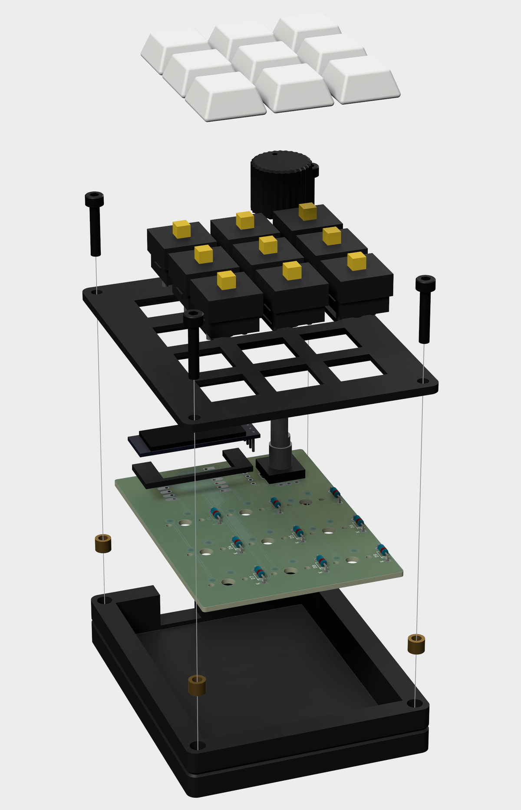

# Frostbite case (CAD)

A flat black sandwich: a plate with four screw heads at the corners, on a plain tray. It is generated in CadQuery from `../design.json`. Shell size, screw positions, boss OD and the USB window come from `case` in that file.



```sh
cd CAD && uv venv --python 3.12 .venv && uv pip install --python .venv -r requirements.txt
cd .. && CAD/.venv/bin/python CAD/frostbite_case.py   # parts, assembly, previews (about 10 s)
CAD/.venv/bin/python CAD/check_fit.py --no-build      # without the flag it rewrites production/
```

## Parts

Exported to `../production/` in print orientation. Everything printed is black PETG. The kit keycaps are white.

| Part | Size (mm) | Est. mass | Notes |
|---|---|---|---|
| Top | 75.15 × 97.15 × 2.5, 5.4 with the tongue | 15 g | Flat MX plate. 1.5 at the 14.0 cutouts, 2.5 elsewhere. Ø3.4 screw holes at the corners. A tongue closes the USB notch from above. |
| Bottom | 75.15 × 97.15 × 14.9 | 41 g | Tray with a 2.5 floor and 6.7 walls. Inserts in the corners. USB notch in the back wall. A shallow V groove runs round the side. |
| OLEDSupport | 33.9 × 13.5 × 1.8 | 0.4 g | C-shaped part between the OLED module and the PCB. Held once the module is soldered. |
| Knob | Ø18 × 15 | 3 g | D-bore Ø6.2, 4.7 across the flat, 12.3 deep. |

Mass is a flow-model estimate at 4 perimeters and 25 % infill, about 60 g in all.

The case is 75.15 × 97.15 × 17.4. Screw heads rise to 20.4 above the desk. With keycaps and knob the whole pad is 39.9 tall.

### Vertical stack (z = 0 at the PCB underside)

```
 +9.60  screw head top
 +6.60  Top face = plate top (PCB top + 5.0, fixed by the MX switch), heads seat here
 +6.05  OLED glass top
 +5.10  plate underside at the clips (1.5)   +5.60 lip underside   +4.60 OLED board top
 +4.10  plate underside (2.5) = Bottom rim, inserts press in from here   +3.40 OLED board underside
 +1.17  top edge of the USB window, on the Top tongue
 +0.10  insert bottom
 0..1.6 PCB, in a pocket of PCB + 0.3 per side (61.75 × 83.75)
 -2.83  USB-C centre = centre of the 13.5 × 8 window
 -8.30  floor top
 -9.40  screw tip
 -9.80  blind hole end
-10.80  underside
```

### Design decisions

- **Height 17.4.** A kit M3×16 from the plate top ends at -9.4. The blind hole runs 0.4 past the tip and leaves a 1.0 floor. That sets the underside. The inserts sit at the rim, so the thread engages all 4 mm.
- **Border 7.0.** Each screw axis sits 3.0 outside the PCB corner in x and y. That leaves 1.47 of wall from the insert hole to the pocket corner and 1.65 to the skin. The limit is 1.3. Coupon 2 tests this real corner.
- **Assembly path.** The PCB hangs from the 9 soldered switches and drops into the tray with the Top. Nothing printed may stand in that path, so the bosses sit outside the PCB envelope.
- **USB-C.** The XIAO receptacle overhangs the PCB, so the back wall has a notch open at the rim. A tongue on the Top closes the notch and forms the 13.5 × 8 window. The window leaves 0.5 per side around a 12.5 × 7 overmold.
- **PCB support.** The PCB hangs from the switches. The back 26 mm has no switch, so hard pushes there flex it slightly (estimated 0.35 mm at 10 N).
- **EC11 opening.** The plate is only 0.5 above the EC11 body, so the opening clears the body: 12.98 × 16.0, r 2. Its corners reach 9.49 from the shaft against the knob's 9.0, so it shows from shallow angles.
- **OLED.** A standard 2.5 header would put the glass 0.15 proud, so the plastic comes off and the OLEDSupport sets the height at 1.8. The glass ends 0.55 below the plate. The window is 31.0 × 12.98 around the 30 × 11.5 glass, enough for ±1° and ±0.1 of misalignment. The feet sit under both ends of the glass.

## Print settings

PETG, 0.4 mm nozzle, 240 °C / bed 80 °C, 4 perimeters, 25 % gyroid, **no supports on any part**.

| Part | Orientation (as exported) | Layer | Notes |
|---|---|---|---|
| Top | top face down on textured PEI | 0.2 (0.16 for nicer cutouts) | Print a cutout test first. If switches are tight, use 0.05 hole/XY compensation. |
| Bottom | underside on the bed | 0.2 | No bridges. |
| OLEDSupport | flat | 0.2 | 2 walls, 100 % infill. |
| Knob | upright, bore opening on the bed | 0.12 | 5 perimeters. Ream the D-bore if it is tight. |

## Assembly order

Print the coupons in `docs/coupons/`, the knob and the OLEDSupport first, and measure the kit OLED (see Measure first). Soldering detail is in `docs/BUILD.md`. Test before step 14.

1. Heat-set 4 inserts into the Bottom corners, flush with the rim, iron about 230 °C.
2. Solder the XIAO flat on the underside and flash `bringup.uf2` with BOOT.
3. Solder the 9 diodes flat on the top side, ≤ 2.2 mm tall.
4. Solder the EC11 on the top side.
5. Trim all underside tails to ≤ 2.0 mm.
6. If the OLED header is loose, solder its short pins up through the module and trim flush. Check pin labels against the silkscreen beside J1.
7. **Slide the black plastic strip off the pins** toward the free ends. Without this the glass stands proud.
8. Lay the OLEDSupport on the PCB: small foot by J1, large foot at the far end, rail on the side facing the keys.
9. Put the pins through J1 and press the module down onto the support. Square it: back PCB edge to the module's long edge reads 7.0 mm at both ends, within 0.5.
10. Solder the 4 J1 pins from the underside and trim to ≤ 2.0 mm. The support is now held. **Test the OLED and knob.**
11. Clip the 9 switches into the plate from the top face. Check every pin is straight.
12. Turn the Top upside down on two blocks at least 22 mm tall under the plate margin. The encoder shaft stands 19.5 proud, or 21.5 on a generic EC11.
13. Lower the PCB straight down onto the switches, underside facing you. The shaft enters its opening about 22 mm before the PCB seats, the switch holes at 3.3 and the OLED recess at 2. If it stops, lift out and look.
14. Solder the 18 switch joints from underneath. Trim to ≤ 2.0 mm. Test every key, then flash `firmware.uf2` while BOOT is reachable.
15. Lower the Top and PCB together straight into the Bottom. The USB receptacle drops into the notch and the tongue follows it.
16. Drive 4 M3×16 from the plate top until snug. PETG creeps, so don't over-tighten.
17. Press on the keycaps and the knob, D-flat aligned.

To reach BOOT and RESET later, remove the 4 screws and lift the Top and PCB out.

## Measure first

Measure the kit OLED before printing. The case leaves 1.0 for the ribbon above the board and 1.1 past the far end (widen `oled.window` if it needs more), and 1.0 for trimmed joints (trim again). Check for parts under the feet at x 3.5 to 9.5 and 32.2 to 37.4, and move the feet if there are any. Glass is assumed 1.45 thick and the module 38 long. A 36 module means shifting the window.

## What `check_fit.py` verifies

Interference between every part and placeholder, the pocket, cutouts, inserts, USB and OLED fit, and print limits (no overhang over 45°, bridges ≤ 10 mm, walls ≥ 0.8). It sweeps assembly steps 1, 11, 13 and 15 to 17 along their straight paths, including the OLED turned ±1°. Three self-tests must block the sweep or it proves nothing. Every pad in `PCB/build/bottom_pads.json` is a keep-out.
