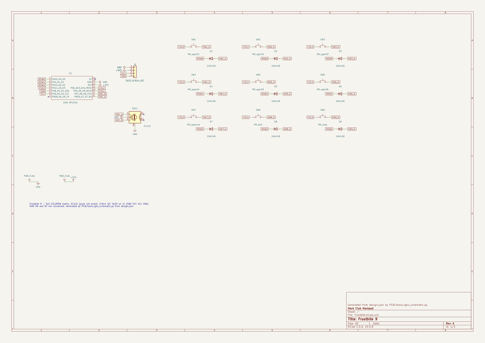
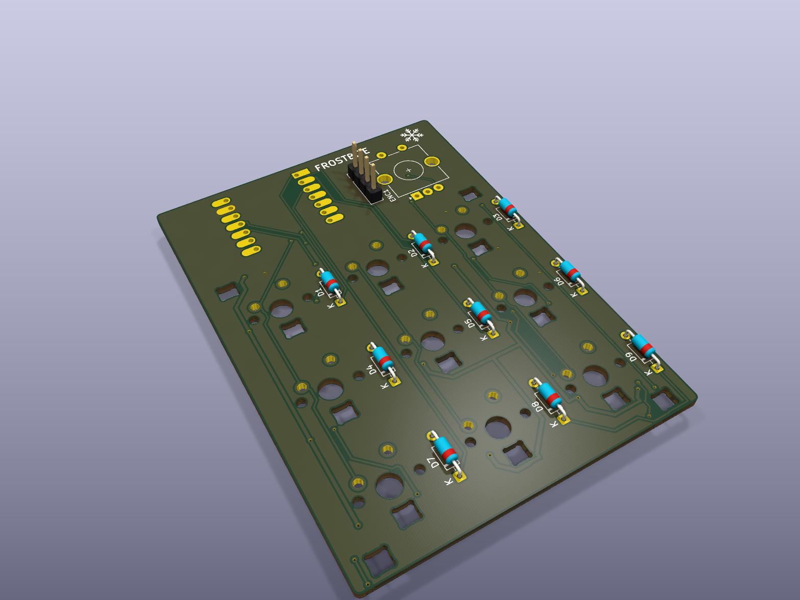
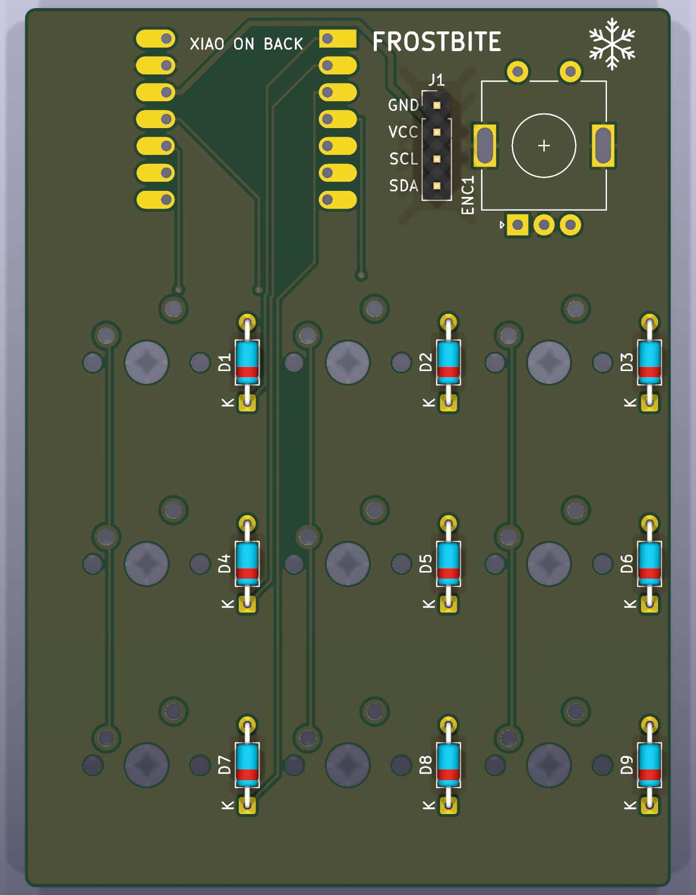
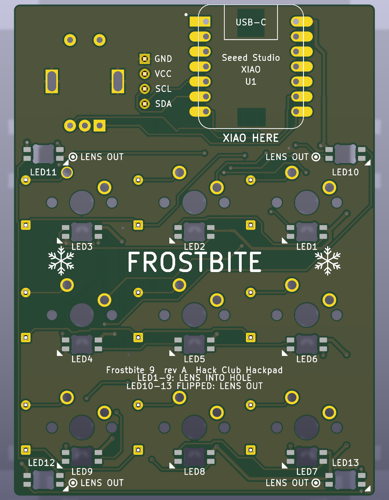

# Frostbite 9 PCB

KiCad 10 project (open `frostbite.kicad_pro`): 3×3 MX keys, EC11E encoder, 0.91" I²C OLED, 13 × SK6812 MINI-E and a Seeed XIAO RP2040 on the underside. Two layers, 61.15 × 83.15 mm. Plots: [front](images/pcb_front.png), [back, mirrored](images/pcb_back.png).

| | |
|---|---|
|  |  |
|  |  |

## Regenerate

Everything is generated from `../design.json`; nothing was placed by hand. `sh PCB/tools/build_all.sh` runs:

1. `make_libs.py`: derived footprints, lib tables, and on first run the project file with net classes (Default 0.25 mm, Power 0.5 mm for GND, +5V, +3V3; clearance 0.2 mm).
2. `gen_schematic.py`, then ERC. UUIDs are deterministic, so the PCB stays linked across runs. `check_netlist.py` then recomputes every net from `design.json` and checks it and `keyboard.json` against the exported netlist.
3. `gen_pcb.py place` (KiCad's bundled Python): outline with R 1.0 corners, footprints, nets, silkscreen, Specctra DSN.
4. `gen_pcb.py route`: Freerouting 2.5.0 headless with DSN clearance raised to 0.3 mm so traces stay clear of the board edge and LED cut-outs, neck-downs widened back to 0.2 mm, then GND pours.
5. DRC with schematic parity, `export_bottom_pads.py` (`build/bottom_pads.json`, used by the case checks), then Gerbers, drill, pos file, `production/gerbers.zip` and images.

`frostbite.kicad_dru` holds JLCPCB 2-layer 1 oz rules from `verify/rules/`, with the PTH annular ring raised from 0.18 to JLCPCB's published 0.20. `gerbers.zip` has F/B Cu, Mask, Paste, Silkscreen and Edge.Cuts with Protel names, silk clipped at the mask, PTH/NPTH Excellon drill and a job file. Last results (KiCad 10.0.8): ERC 0 violations. DRC 0 errors, 0 unconnected, 0 parity issues; at all severities 26 warnings, 25 from care-package XIAO silk plus the SW3 pad below. Netlist 0 differences (35 named nets, 109 pins, 34 parts). Freerouting 0 unrouted, 499 track segments, 40 vias.

## Footprints

* Care package, `github.com/hackclub/hackpad`, `extras/kicad_care_package/`: the XIAO and SK6812MINI-E symbols, `XIAO-Generic-Hybrid-14P-2.54-21X17.8MM` and `SK6812MINI-E_fixed` at `clean` `fb6f7d2cd5d704b01ff011619e0581c751318d15`; `MX-Solderable-1U` at `main` `ff97fbd16f7aa6db5860ee1d027b3caf95594599`. Diodes and J1 are KiCad standard (`D_DO-35_SOD27_P7.62mm_Horizontal`, `PinHeader_1x04_P2.54mm_Vertical`).
* `lib/frostbite.pretty/SK6812MINI-E_key`: pads moved 0.175 mm outward and shortened on the inside (copper 2.15–3.40 mm from centre), so copper is ≥ 0.3 mm from the routed LED cut-out. The originals are 0.1 mm from it, which fails JLCPCB's copper-to-edge rule.
* `lib/frostbite.pretty/SK6812MINI-E_glow_down`: the same on F.* layers. Flipped to the bottom it is a MINI-E on the underside with the lens facing out of the board, so its pins mirror the per-key LEDs.
* `lib/frostbite.pretty/EC11E-Switch_Vertical_H20mm_Slot3.4x1.5`: KiCad's slotted EC11E with 3.4 × 1.5 lug slots and 4.0 × 2.1 pads.
* SW3's pad 2 is reduced to Ø2.0 on the board only, because LED11's GND pad sits 0.84 mm from that joint. DRC notes this as one footprint mismatch. Do not "update footprints from library" on SW3 without restoring it.

## Assembly

All 13 MINI-Es solder to B.Cu pads around an identical cut-out, but the glow LEDs go in the other way up:

| | LEDs | Fit | Light |
|---|---|---|---|
| Key LEDs | LED1–LED9 | Lens **into** the hole, back of the part facing you | Up, into the switch |
| Glow LEDs | LED10–LED13 | **Flipped: lens out**, facing you, back of the part in the hole | Down, into the glow band |

Both ways, line the chamfered lead up with the board's triangle. The four pads form a 5.55 × 1.5 mm rectangle, so a part sits at 0° or 180°, and a part the wrong way up can never put its chamfer on the triangle. If the chamfer will not line up, stop and turn the part over. The silkscreen shows `LENS OUT` and a ring-and-dot mark beside each glow LED.

Soldered lens-in at a glow position, neither VDD nor GND reaches its own pad: the supply leads land on `LED_D9`/`LED_D10` and the rails on the data pins. Expect the glow chain to stay dark and LED9's DOUT to be at risk. This is worked out from pad geometry; nothing has been built. Glow LEDs get data through LED1–LED9, so fit those first, then fit LED10 alone and test it with `led-test.uf2` before fitting the rest. Solder the XIAO to the underside (`XIAO HERE`) with its components facing away from the PCB.

## Placement

PCB coordinates in mm, origin top-left, y down. `kicad-cli pcb export pos` negates y; ENC1's origin is pad A (46.65, 20.5) and J1's is pin 1.

| ref | where | position |
|---|---|---|
| SW1–SW9 | top | switch centres at `design.json keys[]` |
| D1–D9 | top, vertical in the 5 mm gap right of each switch | (x + 9.525, y), anode up, cathode (K, square pad) at y + 3.81 |
| LED1–LED9 | underside, lens into the cut-out, shining up | (x, y + 5.08) under each switch's LED window; LEDn = chain index n−1 per `keys[].led` |
| LED10–LED13 | underside, flipped, shining down | (5.0, 25.4) (56.15, 25.4) (56.15, 80.6) (5.0, 80.6) |
| U1 | bottom (flipped), USB-C toward y = 0 | rect 12.1…29.9 × 0…21.0, centre (21.0, 10.5) |
| ENC1 | top, rotated 90° so the A/C/B row faces the keys, clear of J1 | shaft (49.15, 13.0); A/C/B at y 20.5 (x 46.65/49.15/51.65); S1/S2 at y 6.0; lugs (43.55, 13.0) (54.75, 13.0) |
| J1 | top | pin row x 39.0, pins 1–4 at y 9.19 / 11.73 / 14.27 / 16.81 = GND, VCC, SCL, SDA |

## GND pours

The XIAO's back sits on this board with bare VIN, GND, SWCLK, SWDIO and RST pads plus USB shell tabs. Rule area `xiao_back` (x 15.4–26.6, y 0.4–21) keeps B.Cu tracks and vias out. `xiao_vin_gnd` (x 18.5–23.3, y 17.5–20.65) and `xiao_swd_rst` (x 18.7–23.3, y 0.7–5.5) also clear the pour. Pad positions are scaled from Seeed's render (± 0.3 mm). The rest of the pour stays, insulated by solder mask only, and it is GND.

Pours on both layers use thermal relief on every pad (gap 0.3, spoke 0.4). LED9 and LED11 pad 3 have no pour contact and connect by their 0.5 mm GND tracks. `min_resolved_spokes` is 1 because U1 pad 13, the only XIAO GND pin, gets 2 spokes on F.Cu but 1 on B.Cu. Those three 0.4 mm spokes carry the 0.48 A worst case.

## Encoder lugs

The lug is 2.5 mm wide with a barb tip 6.55 mm from the shaft. KiCad's 2.8 × 1.5 slot at ±5.6 fails JLCPCB's 2:1 slot rule, and the barb must flex 0.50 mm at the lug corners. This board's 3.4 × 1.5 slot at ±5.6 passes at 2.27:1, with flex of 0.20 mm at the centre and 0.26 mm at the corners. Width and centre match KiCad's slot, which six reference boards use, so the barb still catches the outer edge and the extra length adds no play across the lug. Figures are from Alps' STEP model; a kit clone may differ.

## OLED pin order

The common 0.91" 128×32 module, display side up with the header at the right end, presents GND, VCC, SCL, SDA from the back edge to the front edge. A vendor photo and the gorbachev footprint the Hackpad guide links agree, so J1 matches `design.json`. Some clones swap GND and VCC, so compare the kit module's labels with the `GND VCC SCL SDA` silkscreen beside J1 (on both faces) before soldering.

## Nets

| net | |
|---|---|
| ROW0 / ROW1 / ROW2 | XIAO D0/D1/D2 (GP26/27/28) to the cathodes of D1–3 / D4–6 / D7–9 |
| COL0 / COL1 / COL2 | XIAO D3 (GP29) / D9 (GP4) / D10 (GP3) to pin 1 of the switches in column 0 / 1 / 2 |
| SW1_D … SW9_D | switch pin 2 to its 1N4148 anode (COL2ROW) |
| SDA / SCL | XIAO D4 (GP6) / D5 (GP7) to J1 pin 4 / pin 3 (I²C1; the module has its own pull-ups) |
| ENC_A / ENC_B | XIAO D7 (GP1) / D8 (GP2) to encoder A / B (C and lugs to GND; push switch S1/S2 not connected) |
| LED_DIN, LED_D1 … LED_D12 | XIAO D6 (GP0) to LED1 DIN (3.3 V data into a 5 V chain, see `../docs/VERIFICATION.md`), then LEDn DOUT → LED(n+1) DIN; LED13 DOUT is not connected |
| +5V | XIAO 5V (VBUS) to every SK6812 VDD (0.5 mm tracks, 0.375 mm over about 26 mm where Freerouting necked them down) |
| +3V3 | XIAO 3V3 to J1 pin 2 (OLED VCC) |

## For the case

* Bottom side: XIAO ≈3.5 mm (allow `xiaoDetail.tMax` 4.5 + 0.5). Per-key LED backs protrude ≈0.94 mm below B.Cu, glow LED lenses ≈0.84 mm, THT lead ends ≈1.7–2 mm.
* USB-C: receptacle centred at x = 21.0, 9.0 wide, on the underside, overhanging y = 0 by 1.42 mm per Seeed's footprint (Seeed's STEP gives 1.0; the case fits either). The XIAO board edge is flush with y = 0.
* Top side: only the diodes (Ø 2 mm, under the plate), J1 and ENC1. The OLED outline (x 2.5–40.5, y 7–19) is free of parts apart from flush XIAO pads. No mounting holes: `design.json` puts the M3 inserts in the bezel, outside the PCB.
