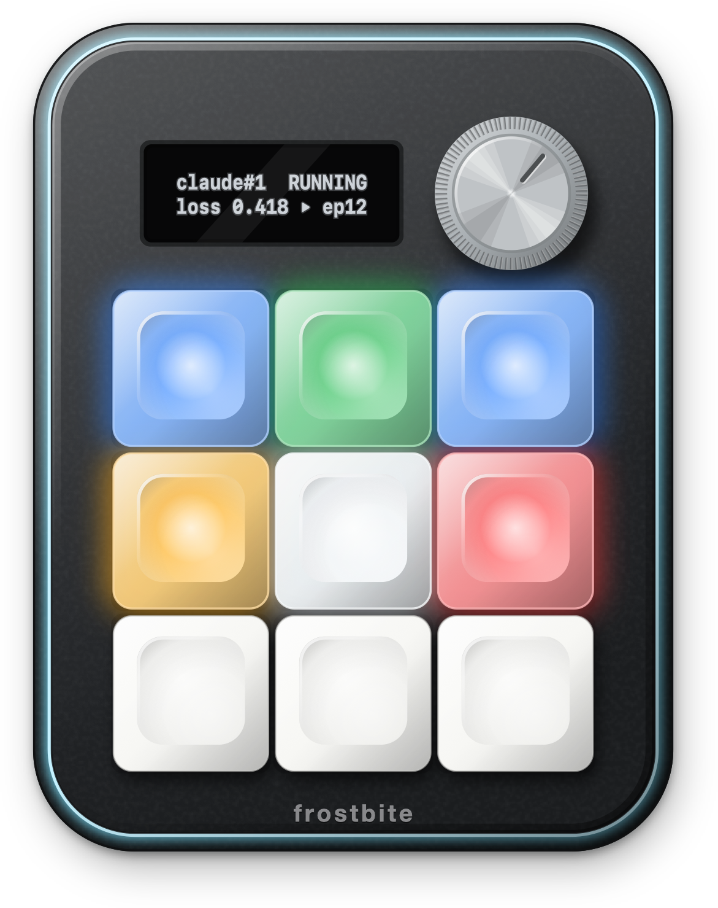
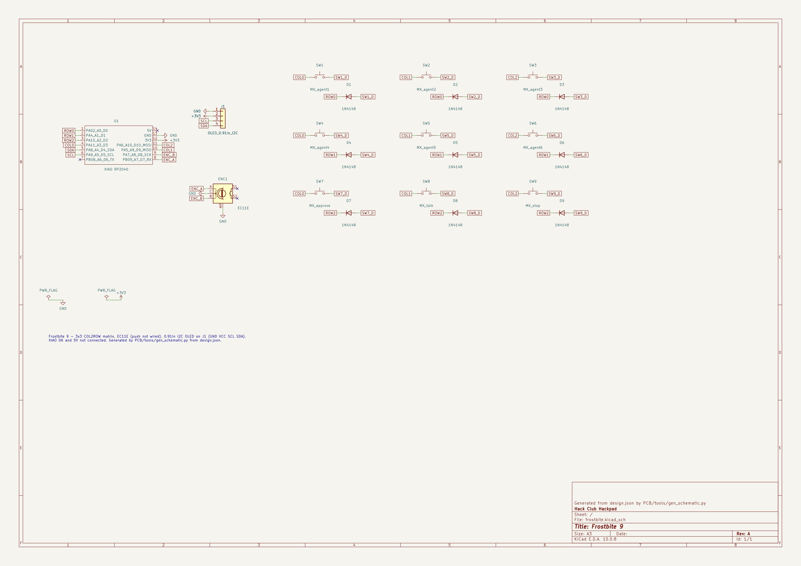
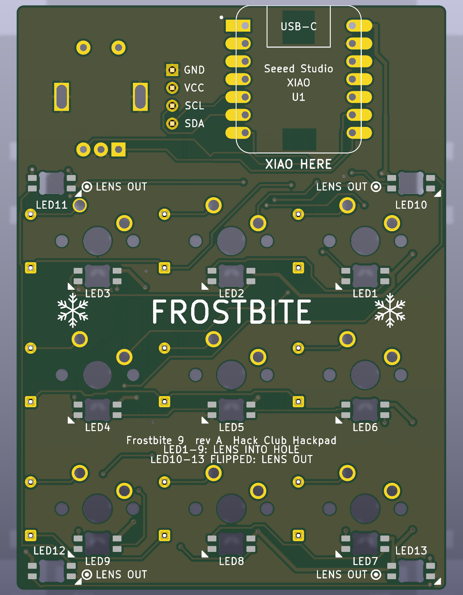

# Frostbite




*Left: an illustration of the look. Right: the CAD assembly.*

A 9-key [Hackpad](https://hackpad.hackclub.com) macropad that shows what my Claude Code sessions and ML training
runs are doing. The design files are done, but I haven't built it yet, so nothing here has been tested on real hardware.

<!-- TODO: add 2-3 sentences in your own words about why you built this. Stardance wants that part to be yours. -->

## How it works

Each of the top six keys is one session or training run, and its colour shows the state:

| Colour | State |
|---|---|
| Dim white | Idle |
| Blue | Running |
| Green | Done |
| Amber, pulsing | Waiting on me |
| Red, blinking | Error (traceback, NaN loss, out of memory) |


Tap a key to select it and bring its tab forward. Hold it to open its log.

The bottom row is Approve, Talk and Stop. Approve answers the Claude Code permission request on the OLED, and holding
it denies. After 30 s, or for questions and plan approval, you answer in the terminal. Talk is F20, for push-to-talk
dictation. Stop sends Escape to the selected session, but only on macOS, in Terminal or iTerm2, while that session is
running and its tab is in front. Otherwise it does nothing and the OLED says why.

The dial picks which slot the OLED shows. A clear band under the top shell glows red if something failed, amber if
something is waiting, and ice blue otherwise.

If the laptop script isn't running, the keys fall back to F13-F20, the dial changes the volume, and Stop is a plain
Escape to whatever app is in front.

## CAD Model


The case is printed in five parts: Top, Bottom, GlowBand, a small OLEDSupport and an optional knob. The Top and Bottom
are matte black PETG so it doesn't show dirt easily. The GlowBand is clear PETG and sits between them.
Four M3 screws go in from underneath, into heat-set inserts in the Top. It measures 79.15 × 97.15 mm with a 4° tilt.

Black plastic absorbs stray light, which makes the band the riskiest part of the look. I'll print
[the glow test piece](docs/coupons/README.md) before committing to the full case.

The full assembly is `CAD/frostbite-assembly.step`. Files for printing are in `production/`.

## PCB






2-layer, 61.15 × 83.15 mm. Scripts in `PCB/tools/` generate it from `design.json`, and Freerouting routes it. A XIAO RP2040 sits on the underside, and 13 SK6812 MINI-E LEDs share one data
line: nine under the keys and four for the band. That uses all 11 GPIO, so the dial's push switch isn't wired.

Gerbers are in `production/gerbers.zip`. The pin map is in [Firmware/README.md](Firmware/README.md).

## Firmware Overview

QMK, in `Firmware/qmk/keyboards/frostbite/`. The `default` keymap talks to the laptop over Raw HID. The `ledtest` keymap
checks the LEDs and OLED during assembly.

For the first flash, hold BOOT on the XIAO while plugging it in, then drag `production/firmware.uf2` onto the RPI-RP2 drive. Build
steps and the HID protocol are in [Firmware/README.md](Firmware/README.md).

## Laptop script

`host/` is a Python daemon for macOS (Python 3.12+). It reads Claude Code hooks and training logs, then tells the pad
what to show. To try it without hardware, run these and then `frostbite-ctl set 1 run demo` in another terminal:

```bash
uv tool install ./host
frostbite-daemon --fake --dry-run
```

Hook setup is in [host/README.md](host/README.md). `design.json` holds the pins and positions that the PCB, case and
firmware are checked against. `studio/` is the browser tool I used to compare designs.

## BOM

| Part | Qty | From |
|---|---|---|
| Seeed XIAO RP2040 | 1 | Kit |
| Gateron Yellow KS-3 switches | 9 | Kit |
| White DSA keycaps | 3 | Kit |
| 1N4148 diodes | 9 | Kit |
| Alps EC11E encoder | 1 | Kit |
| 0.91" 128×32 OLED | 1 | Kit |
| SK6812 MINI-E LEDs | 13 | Kit |
| M3×16 screws and heat-set inserts | 4 each | Kit |
| PCB | 1 | JLCPCB |
| Top, Bottom, OLEDSupport | 1 each | Printed, matte black PETG |
| GlowBand | 1 | Printed, clear PETG |
| Frosted translucent DSA keycaps | 6 | Buy (kit caps are opaque) |
| 18 mm knob, 6 mm D-shaft | 1 | Buy, or print `Knob.stl` |
| Thin double-sided tape, stick-on feet | 1, 4 | Buy |
| USB-C data cable | 1 | Buy |
| 4-pin 2.54 mm header | 1 | Only if the kit OLED has none |

The full list is in [docs/BOM.md](docs/BOM.md), and prices go in [BOM.csv](BOM.csv).

## Testing

`verify/run.sh` compares pin maps, PCB and case positions and design rules, builds the firmware and runs the laptop
script's tests. None of that touches hardware. These still need real parts:

- whether 3.3 V data drives the 5 V LEDs reliably
- how bright the band looks in a black case
- which way up the OLED needs to be, and how the dial steps
- whether the OLED ribbon clears the case
- whether the four flipped glow LEDs seat and work
- Approve and Stop in a live Claude Code session

The step-by-step build is in [docs/BUILD.md](docs/BUILD.md).

## Credits

The layout comes from [Stratum](https://github.com/ReuTheCoder/stratum-macropad). The status colours follow the Codex
Micro (OpenAI × Work Louder). The floating plate comes from the
[Banchan BDN9 case](https://makerworld.com/en/models/1008755), and the caps lit from below from
[froskeys](https://github.com/frosetrain/froskeys). [Matyas's Hackpad](https://github.com/Matyas604/Matyas-s-Hackpad) is a
good example of the black case with light caps.

I used Claude Code heavily on this project, including the CAD scripts, PCB generation, firmware, laptop script and docs.
