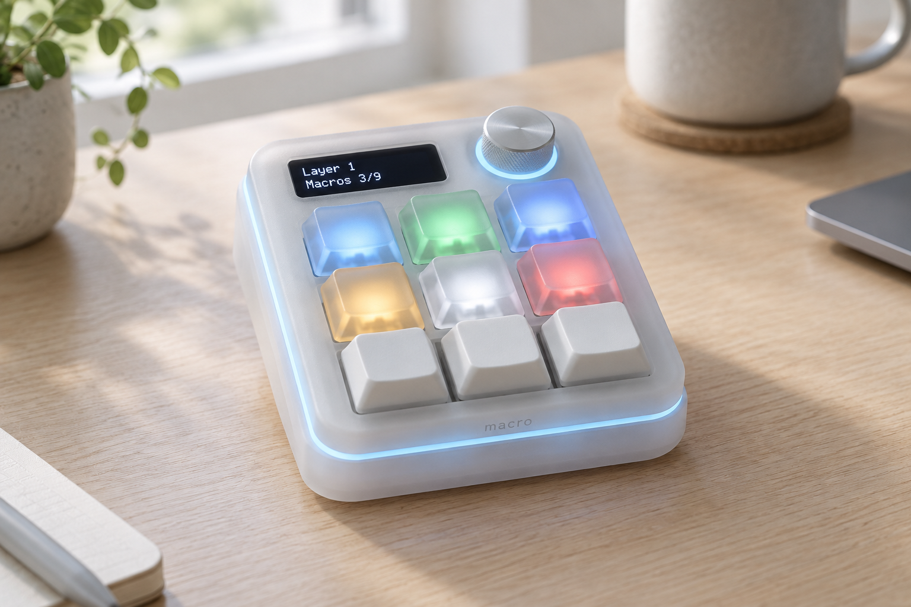
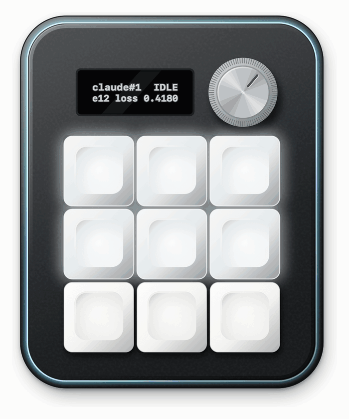
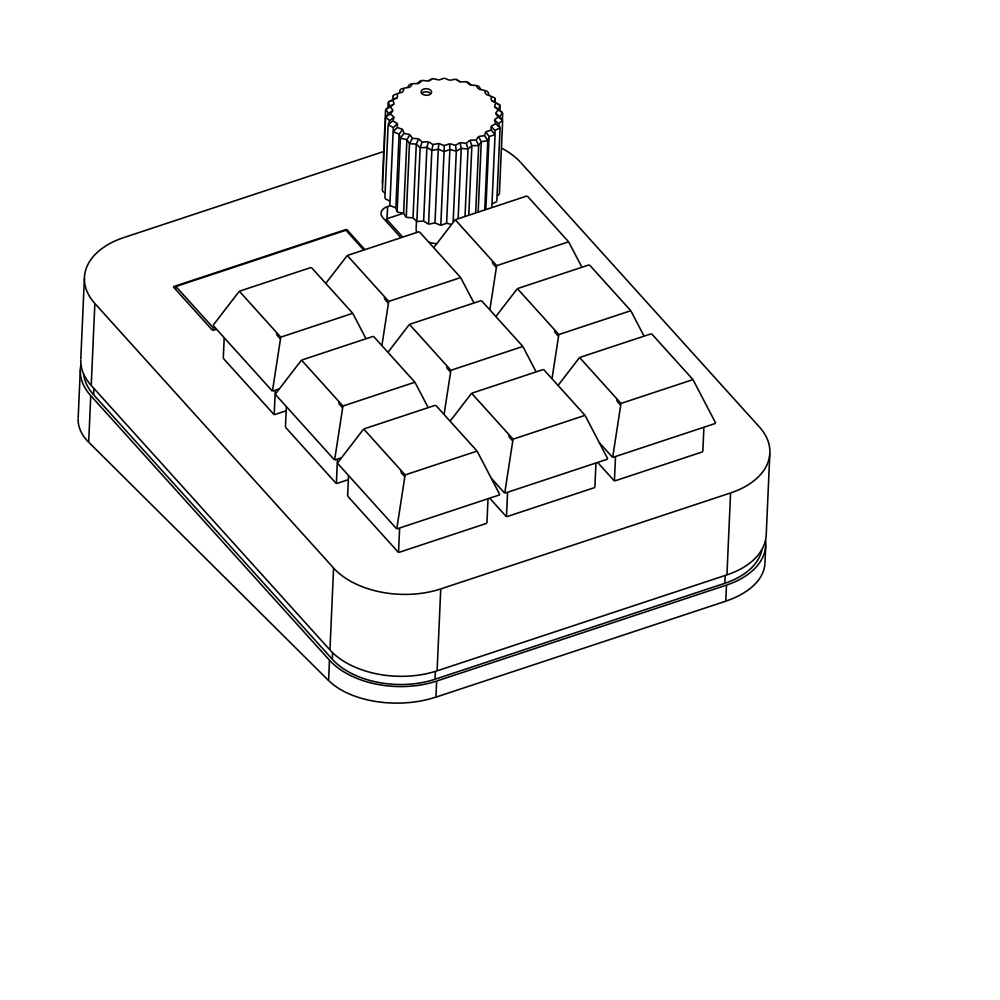
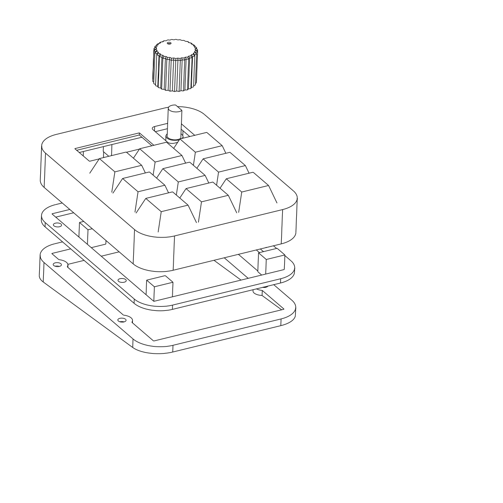
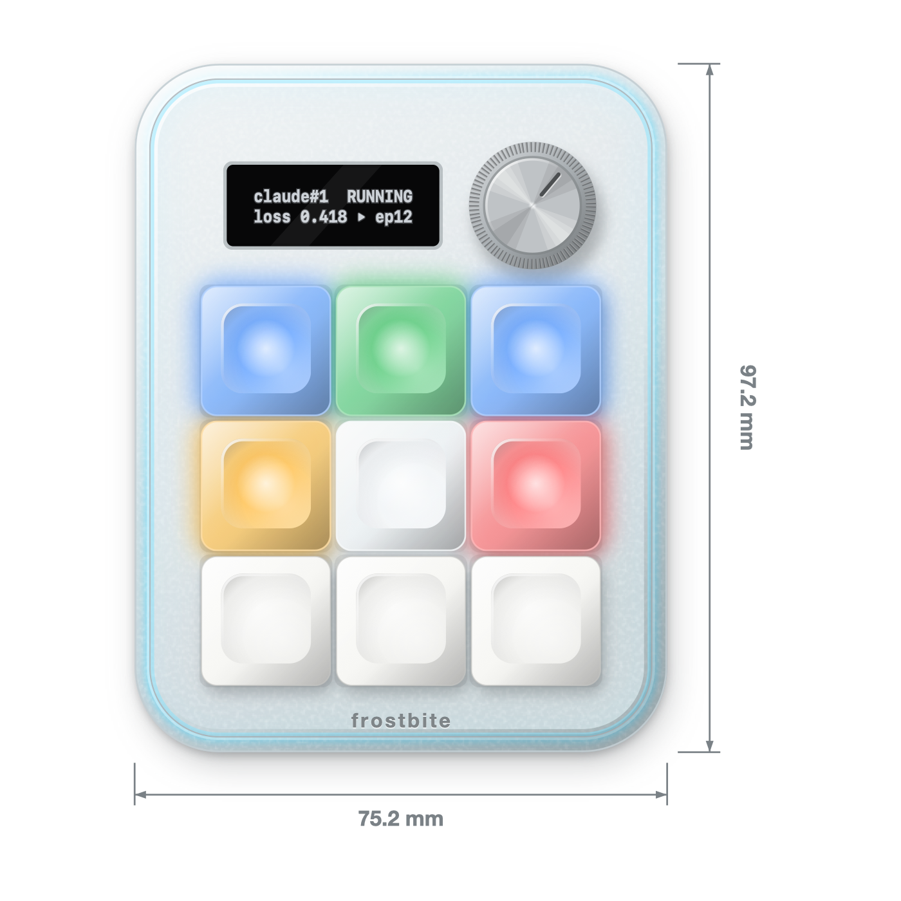
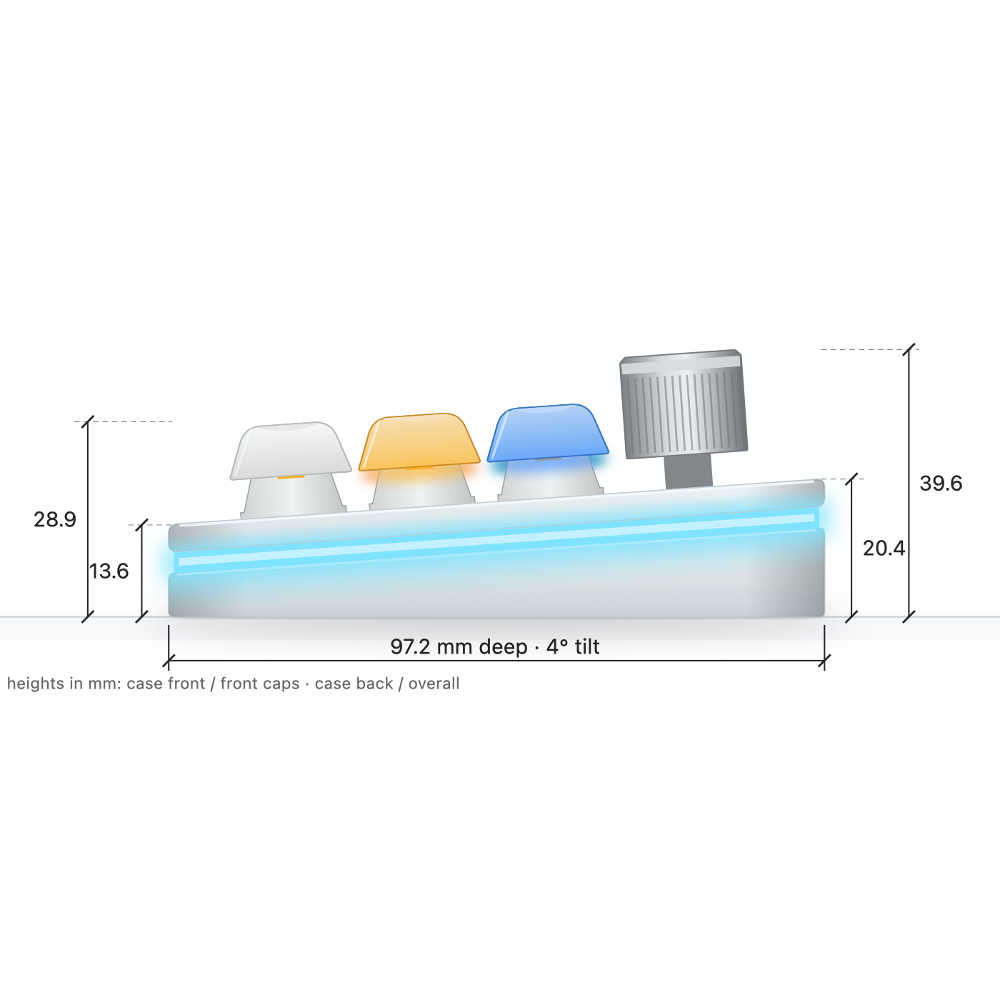
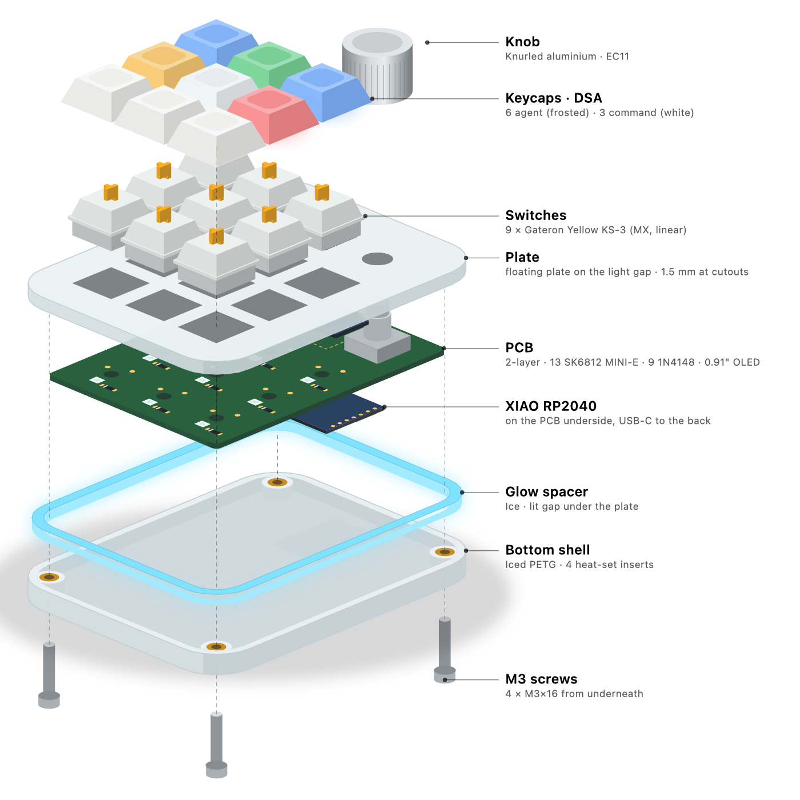
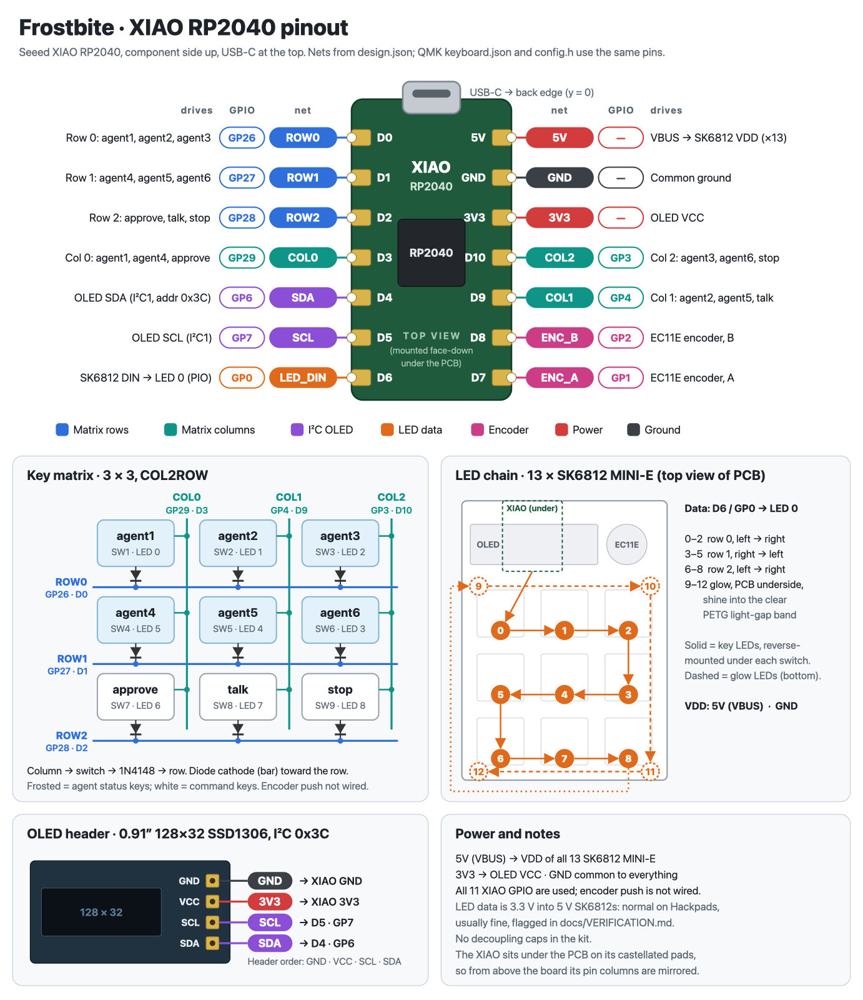
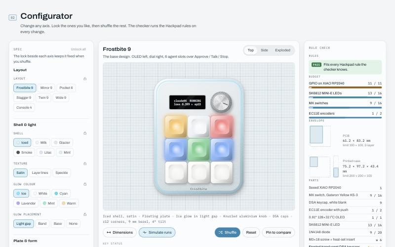
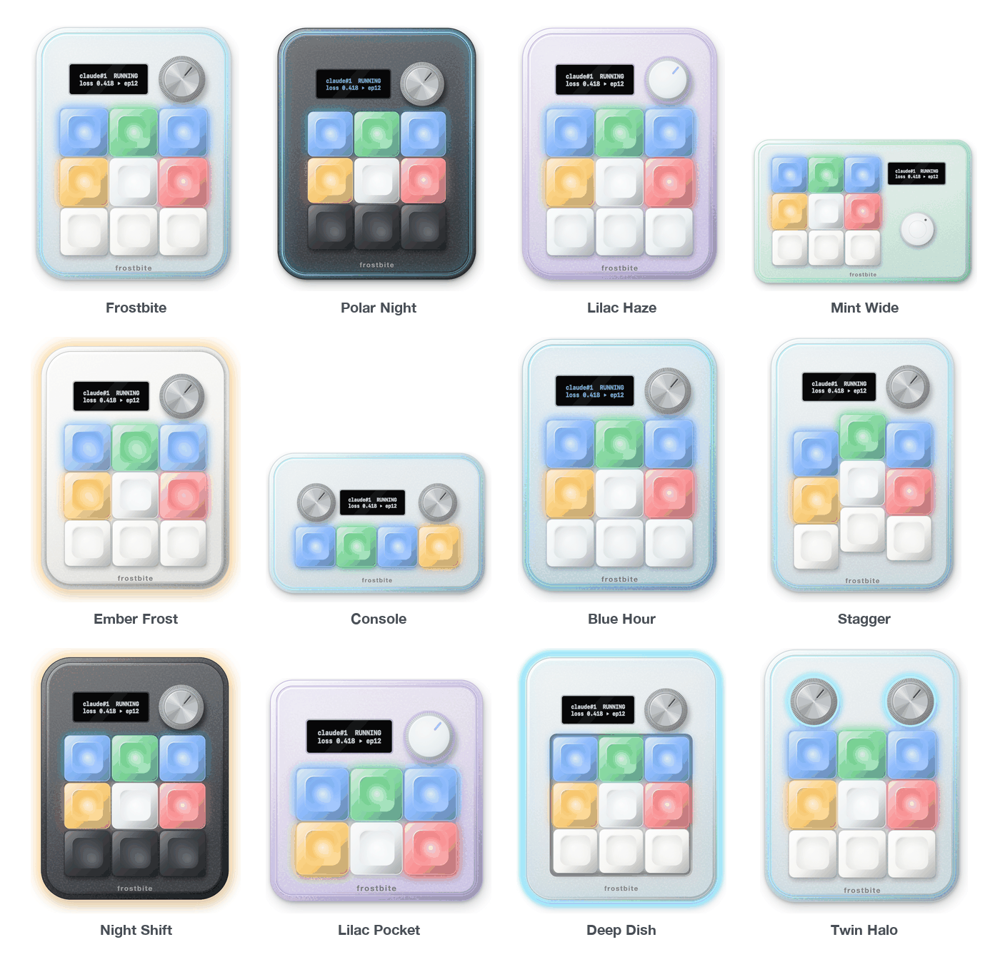

# Frostbite



*AI-generated concept render of the intended look, not a photo of a build.*

Frostbite is a 9-key [Hackpad](https://hackpad.hackclub.com) macropad that shows what my AI coding agents and
ML training runs are doing. Six frosted agent keys glow a status colour, one per running session. Three command
keys (Approve, Talk, Stop) answer them without switching windows. A small OLED and a dial pick which session
you are looking at. A daemon on the laptop feeds the pad over Raw HID.

## Features

- **6 agent slots + 3 command keys** in a 3×3 grid of Gateron Yellow KS-3 switches. The top two rows are
  agent slots 1-6; the bottom row is Approve / Talk / Stop.
- **Status colours** on each agent key (SK6812 MINI-E under every switch, frosted translucent caps):

  | Status | Colour | Typical source |
  |---|---|---|
  | idle | dim white `#eef2f5` | session open, nothing happening |
  | run | blue `#3d8bff` | agent working, training step logged |
  | done | green `#2fbf5b` | agent stopped, run finished |
  | needs | amber `#ffb020`, slow pulse (2.4 s) | permission prompt waiting on me |
  | error | red `#ff4d4f`, blinks at 1 Hz | NaN loss, traceback, out of memory |

  

- **0.91" 128×32 OLED** (SSD1306, I²C at 0x3C): name, status and detail of the selected slot, e.g.
  `claude#2 my-app  WAIT` / `Bash(npm test)?`, or `e3 s812 loss 0.4213` for a training run.
- **EC11 dial** with an 18 mm knob: turn to step through the six slots.
- **Light gap**: the top shell floats over a 2 mm clear PETG band lit by 4 more LEDs. It glows red if anything
  failed, amber if anything is waiting on me, ice blue otherwise.
- **13 LEDs** on one data line: 9 per-key + 4 glow.
- **Seeed XIAO RP2040** using all 11 GPIO (3 rows, 3 columns, I²C, LED data, encoder A/B).
- **Works without the companion**: if the host stops pinging for 5 s, the keys fall back to F13-F20 / Escape and
  the dial to volume.

## CAD Model




`CAD/frostbite-assembly.step` is the full assembly with the PCB. `python CAD/check_fit.py` checks the fit
(PCB pocket, switch cutouts, OLED window, USB-C opening, insert bosses vs the PCB's underside pads).

The case is generated from `design.json` in CadQuery and printed in four parts:

| Part | What it does |
|---|---|
| `Top` | Shell and MX plate in one piece (1.5 mm at the switch clips), OLED window, encoder hole, USB-C cutout at the back |
| `GlowBand` | 2 mm band in clear / natural PETG between Top and Bottom; the 4 glow LEDs shine down into it |
| `Bottom` | Base with a 4° typing tilt; the M3 screws go in from underneath so none show from above |
| `Knob` | Optional printable 18 mm knob for the 6 mm D-shaft (30 knurl ribs) |

- Outer shell 75.15 × 97.15 mm, 12 mm corner radius, 9 mm bezel.
- 4 × M3 heat-set inserts (4.7 mm hole, 4 mm deep) in the Top's side walls, M3×16 screws up from underneath
  through Bottom and GlowBand. The bosses tuck under the PCB edge, so they are placed clear of the underside pads.
- 0.3 mm tolerance per side where print meets PCB.
- Outputs: `CAD/frostbite-assembly.step` (full assembly with the PCB) and `production/{Top,GlowBand,Bottom,Knob}.{step,stl}`.




How it fits together (studio exploded view, top to bottom): knob, keycaps (6 frosted, 3 white), switches, plate,
PCB with the XIAO on its underside, glow band, bottom shell with the heat-set inserts, M3 screws from underneath.



## PCB

KiCad 10 project in `PCB/` (rebuild with `sh PCB/tools/build_all.sh`). ERC, DRC and schematic parity all report
0 errors; every connection is routed. Gerbers are in `production/gerbers.zip`.


2-layer board, 61.15 × 83.15 mm. The XIAO is soldered by its castellated pads on the underside, USB-C at the back
edge. Matrix diodes are 1N4148 through-hole, COL2ROW. The encoder's push switch is not wired (no free GPIO).



| XIAO | GPIO | Net | | XIAO | GPIO | Net |
|---|---|---|---|---|---|---|
| D0 | GP26 | ROW0 | | D6 | GP0 | LED_DIN (SK6812 data, PIO) |
| D1 | GP27 | ROW1 | | D7 | GP1 | ENC_A |
| D2 | GP28 | ROW2 | | D8 | GP2 | ENC_B |
| D3 | GP29 | COL0 | | D9 | GP4 | COL1 |
| D4 | GP6 | SDA (I²C1) | | D10 | GP3 | COL2 |
| D5 | GP7 | SCL (I²C1) | | | | |

- **LED chain** (one data line from D6): per-key LEDs 0-8 run serpentine (top row left to right, middle row right
  to left, bottom row left to right), then glow LEDs 9-12 on the underside, shining down into the band.
- **Power**: XIAO 5 V (VBUS) to the SK6812s, 3V3 to the OLED. The OLED header is GND-VCC-SCL-SDA.
- **Known risk**: 3.3 V LED data into 5 V SK6812s. It usually works on Hackpad builds; it is checked at bring-up
  with the LED test firmware. The kit has no decoupling caps.

## Firmware Overview

QMK, in `Firmware/qmk/keyboards/frostbite/`. Two keymaps: `default` (the agent dashboard, shipped as
`production/firmware.uf2`) and `ledtest` (LED chain and OLED bring-up, `production/led-test.uf2`).

| Key | Host connected (Raw HID) | No host (fallback) |
|---|---|---|
| Agent 1-6 | tap: select slot / focus its terminal; hold (400 ms): open its log | F13-F18 |
| Approve | tap: Return to a waiting prompt; hold: Escape (deny) | F19 |
| Talk | always F20, held while held (bind a push-to-talk dictation tool to it) | F20 |
| Stop | Escape to the terminal (interrupts Claude Code) | Escape |
| Dial | select slot 1-6 (wraps) | volume up / down |

- **Raw HID**: usage page `0xFF60`, usage `0x61`, 32-byte reports. The host sends SET_SLOT, SET_ALL, OLED_LINE,
  SET_GLOW, PING and SET_SELECTED; the pad sends KEY (tap / hold) and ENCODER events. Host mode lasts while a PING
  arrived in the last 5 s. Full table in [Firmware/README.md](Firmware/README.md).
- **OLED**: selected slot and status, a summary such as `3 run 1 wait 2 done`, and a slot strip with `HID` / `KBD`
  mode. Turns off after 10 minutes without activity.
- **LEDs**: cross-fades between colours, the selected slot breathes, and a current limiter keeps total output within
  USB power. Glow defaults to ice blue `#7fe3ff` at about 27 %.

**Flashing**

1. Enter the UF2 bootloader, any of:
   - **bootmagic combo**: hold **Approve + Stop** (bottom-left + bottom-right) while plugging in (also clears EEPROM);
   - double-tap the XIAO **RESET** button;
   - hold the XIAO **BOOT** button while plugging in.
2. A drive named **RPI-RP2** appears. Drag `production/firmware.uf2` onto it. The board reboots by itself.

For bring-up, flash `led-test.uf2` first, before soldering switches: each LED lights red, green, blue, white in
chain order while the OLED shows `LED TEST n/13`.

Build: `qmk compile -kb frostbite -km default` after linking the keyboard folder into `~/qmk_firmware` (steps in
[Firmware/README.md](Firmware/README.md)). USB VID/PID are test values (`0xFEED` / `0x4642`).

---

## BOM

From the Hackpad kit:

- 1x Seeed XIAO RP2040
- 9x Gateron Yellow KS-3 MX switches
- 3x white blank DSA keycaps (Approve, Talk, Stop)
- 9x 1N4148 diodes (through-hole)
- 1x Alps EC11E rotary encoder
- 1x 0.91" 128×32 I²C OLED (GND-VCC-SCL-SDA)
- 13x SK6812 MINI-E LEDs
- 4x M3×16 screws
- 4x M3 heat-set inserts
- 1x PCB, 2-layer, 61.15 × 83.15 mm (JLCPCB)
- Printed case: Top, Bottom (and GlowBand, see below)

Extras to buy:

- 6x frosted translucent DSA keycaps, blank (kit caps are opaque, so status colour would not show)
- 1x 18 mm knob for a 6 mm D-shaft (knurled aluminium; or print `production/Knob.stl`)
- Clear / natural PETG filament, about 50 g, for the GlowBand

| Part | Needed | In kit | To buy |
|---|---|---|---|
| MX switches | 9 | 16 | 0 |
| Keycaps | 9 (6 frosted + 3 white) | 16 white DSA | 6 frosted translucent DSA |
| 1N4148 diodes | 9 | 20 | 0 |
| EC11 encoder | 1 | 2 | 0 |
| OLED 0.91" | 1 | 1 | 0 |
| SK6812 MINI-E | 13 | 16 | 0 |
| M3×16 screws / M3 heat-set inserts | 4 / 4 | 6 / 6 | 0 |
| XIAO RP2040 | 1 | 1 | 0 |
| Knob | 1 | 0 | 1 (or print it) |
| Clear PETG for the GlowBand | ~50 g | - | 1 spool or sample |

## Laptop companion

The status lights are driven by `host/`, a small Python package (install with `uv tool install ./host`):

```
Claude Code hooks ──► frostbite-hook ─┐
frostbite-ctl (CI, scripts) ──────────┼─► unix socket ─► frostbite-daemon ◄──► pad (Raw HID)
--watch-train log / metrics.jsonl ────┘
```

| Command | Role |
|---|---|
| `frostbite-daemon` | Owns the pad, PINGs every 2 s, reconnects after an unplug, runs the training-log watchers, turns key presses into actions |
| `frostbite-hook` | Called by Claude Code hooks; forwards one event, gives up after 0.2 s, always exits 0 |
| `frostbite-ctl` | Manual and scripted control: `set 3 run "CI build"`, `clear 3`, `select 3`, `status`, `watch PATH --name N`, `hooks` |

**Claude Code hooks.** `frostbite-ctl hooks --hook "$(which frostbite-hook)"` prints a snippet to merge into
`~/.claude/settings.json` by hand (nothing edits your settings). Each session claims a free slot:
UserPromptSubmit / PreToolUse set `run`, PermissionRequest and permission Notifications set `needs`, Stop sets
`done`, SessionEnd frees the slot. Line 2 of the OLED shows the prompt or tool, e.g. `Bash(npm test)?`.

**Training runs.** `frostbite-daemon --watch-train train.log --name my-run` tails a text log or `metrics.jsonl`
and reads step / epoch / loss. A NaN or inf loss, a Python traceback, an `...Error:` line or CUDA/MPS out of memory
sets `error`. Lines such as `Training complete` (or your own `--done-pattern`), or a log that stops growing for
10 minutes, set `done`.

**Anything else.** `frostbite-ctl set 3 run "CI build" --detail "deploy #42"` from any script;
`host/examples/gh-actions-slot.sh` mirrors a GitHub Actions run on a slot.

**Keys.** Keystrokes (Return, Escape) are only sent when the frontmost app is a terminal (Terminal, iTerm2,
Ghostty, WezTerm, VS Code), and Approve only acts when the selected slot is `needs`. macOS asks for Accessibility
and Automation permission the first time. Details and a LaunchAgent example: [host/README.md](host/README.md).

Try it without hardware: `frostbite-daemon --fake --dry-run`.

## Verification

`verify/run.sh` checks the whole project against `design.json` from real tool output, gate by gate:

| Gate | What it checks |
|---|---|
| G0 | Design studio harness and unit tests; `design.json` self-consistency (pin map matches Seeed's XIAO pinout, one key per matrix cell, LED indices 0-12, < 16 inputs, PCB ≤ 100 × 100) |
| G2 | QMK `keyboard.json` / `config.h` pins match `design.json`; KiCad netlist nets, matrix paths and LED chain match; ERC has 0 errors |
| G3 | PCB outline and layers, part positions within 0.05 mm, DRC with the project rules and with pinned JLCPCB rules, gerber export |
| G4 | `CAD/check_fit.py`; every STL watertight; the Top plate has 9 cutouts of 14.0 ± 0.1 mm in the design's key pattern |
| G5 | Part counts fit the Hackpad kit; lists extras to buy |
| G6 | `qmk lint`, both keymaps compile, every UF2 is valid for the RP2040 and `production/firmware.uf2` is current |
| G7 | Host test suite (`pytest`) |
| G8 | Submission tree and this README (required images, BOM table, every image link resolves) |
| X | design.json ↔ PCB ↔ case STL positions agree |

**Evidence.** Each check writes `verify/evidence/<check>.json` with every command, exit code, output tail,
measurements, and the SHA-256 of every input file. A claim only counts if its evidence file exists and its input
hashes match the current files. A check is PASS only when every command exited 0 and every value matched;
NOT_RUN (missing input or tool) is never counted as a pass. `verify/run.sh --self-test` injects 25 known faults
(a swapped pin, a moved switch, a truncated UF2, a leaky STL, a screw boss on a solder pad, ...) into copies of the
project and confirms the right check fails for each.

**Current status** (from [verify/REPORT.md](verify/REPORT.md)): **PASS 24 · FAIL 0 · NOT_RUN 0**, self-test 25/25
faults caught. Rerun `verify/run.sh` to refresh.

What the checks do not prove: that the board works once soldered (3.3 V LED data into 5 V SK6812s, solder quality),
that prints come out to size on a given printer, or how anything feels in the hand. Those are checked at bring-up
with `production/led-test.uf2`.

## Design studio

`studio/` is Frostbite Studio, a browser page (open `studio/index.html`, no build step) that draws the design to
scale in code across 7 layouts, 37 presets and every shell, plate, glow, cap and knob option. Each combination is
checked against the Hackpad rules and real part dimensions (`docs/DIMENSIONS.md`), and lists the extras it would
need. `node studio/verify/run.js` runs those checks over about 1,900 combinations. The chosen spec became
`design.json`.





## Repo layout

| Path | What's in it |
|---|---|
| `design.json` | Single source of truth: pins, key and LED positions, case dimensions, HID protocol |
| `CAD/` | CadQuery case script, full assembly STEP, fit checks, previews |
| `PCB/` | KiCad project (schematic, board, libraries) |
| `Firmware/` | QMK keyboard definition and keymaps (`default`, `ledtest`) |
| `production/` | `gerbers.zip`, `firmware.uf2`, `led-test.uf2`, case parts as STEP and STL |
| `host/` | Laptop companion: daemon, Claude Code hook, `frostbite-ctl`, tests |
| `verify/` | Verification harness, evidence files and `REPORT.md` |
| `studio/` | Frostbite Studio design explorer and its own checks |
| `docs/` | Verification plan, part dimensions with sources, images, concept renders |

## Credits

- Layout inspired by [Stratum](https://github.com/ReuTheCoder/stratum-macropad) from the Hackpad gallery.
- Status-colour idea inspired by the Codex Micro (OpenAI × Work Louder). No logos or assets from it are used.
- Floating-plate idea from the Banchan BDN9 case; staggered layout idea from [froskeys](https://github.com/frosetrain/froskeys).
- Concept renders in `docs/renders/` are AI-generated mood images, not photos of a build.
