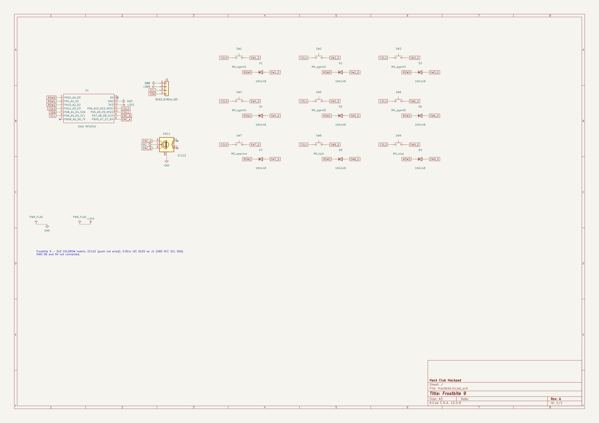
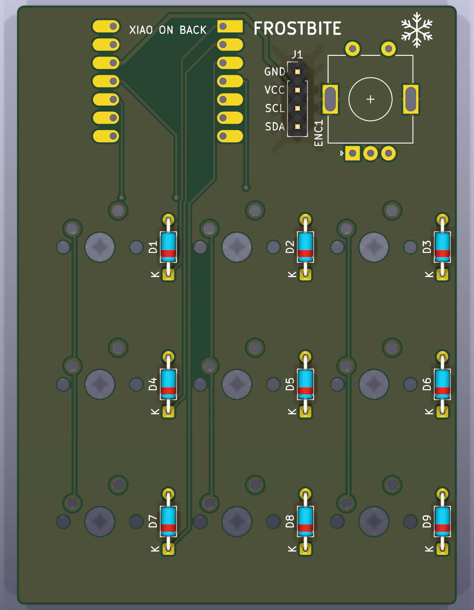
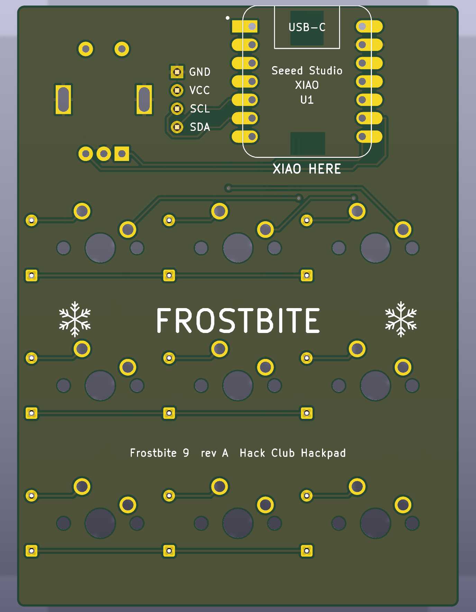

# Frostbite

[](https://kicanvas.org/?repo=https://github.com/michae6345-crypto/frostbite/tree/main/PCB)


Frostbite is a 9-key macropad built around a Seeed XIAO RP2040, with a rotary encoder and a 128x32 I2C OLED. It shows
the status of my Claude Code sessions and ML training runs, and lets me act on them without switching windows.

The repo holds the KiCad PCB, a CadQuery case, QMK firmware in C, and a Python daemon that talks to the pad over raw
HID. Gerbers, case STEP/STL files and a compiled firmware image are in `production/`. The image above is a CAD render,
and nothing here documents a built or tested board yet.

## Hardware

- 2-layer PCB, 61.15 x 83.15 mm. The XIAO sits on the bottom side.
- 3x3 key matrix with 1N4148 diodes (COL2ROW), MX-style switches, an EC11E encoder and a 0.91" OLED.
- Printed case in four parts (Top, Bottom, OLEDSupport, Knob), 75.15 x 97.15 x 17.4 mm. Four M3x16 screws go into
  heat-set inserts in the Bottom. `CAD/frostbite_case.py` generates every case file.
- Parts list with sources and prices: [BOM.csv](BOM.csv).






## Firmware (C, QMK)

About 330 lines of C in `Firmware/`, most of it in `keymaps/default/keymap.c`.

The pad runs in one of two modes. With no host, it is a plain keyboard: the top six keys send F13-F18, the bottom row
sends F19, F20 and Escape, and the knob changes volume. Once the host daemon pings it, the pad switches to host mode.
Key presses become HID reports instead of keystrokes, with tap and hold (400 ms) told apart. The knob then picks one
of six slots. If no ping arrives for 5 s, the pad falls back to keyboard mode. Talk keeps sending F20 in both modes
so it works as a push-to-talk key.

The protocol uses 32-byte raw HID reports on usage page 0xFF60 (VID 0xFEED, PID 0x4642). Byte 0 is the command:

| Byte 0 | Direction | Meaning |
|---|---|---|
| 0x01 | host to pad | set one slot's status |
| 0x02 | host to pad | set all six statuses |
| 0x03 | host to pad | write a line of OLED text |
| 0x05 | both | ping, pad replies with protocol version and selected slot |
| 0x06 | host to pad | set the selected slot |
| 0x81 | pad to host | key event (index, tap or hold) |
| 0x82 | pad to host | encoder turn and new selected slot |

The OLED shows the selected slot, a summary line and a status letter for each of the six slots. It turns off after
10 minutes with no activity.

## Host software (Python)

About 2,650 lines in `host/frostbite_host/`, needing Python 3.12+ and `hidapi`.

- `frostbite-daemon` finds the pad by VID/PID and usage page, keeps slot state and pushes it to the OLED.
- `frostbite-hook` is a Claude Code hook ([host/claude-hooks.json](host/claude-hooks.json)). It reports session events
  to the daemon over a Unix socket. On a permission request it waits for Approve: a tap allows, a hold denies.
- `--watch-train PATH` tails a training log or JSONL file and reads epoch, step and loss from it.
- `frostbite-ctl` sets, clears and selects slots by hand, adds log watches, and prints the hooks config.

Tapping a session key selects it and focuses its terminal. Stop sends Escape to the selected session. Both use `osascript`, so they only
work on macOS.

## Wiring and build

Pin map (from `Firmware/readme.md`, matching `keyboard.json` and `config.h`):

| XIAO | GPIO | Net |
|---|---|---|
| D0 | GP26 | ROW0 |
| D1 | GP27 | ROW1 |
| D2 | GP28 | ROW2 |
| D3 | GP29 | COL0 |
| D9 | GP4 | COL1 |
| D10 | GP3 | COL2 |
| D4 | GP6 | OLED SDA (I2C1, address 0x3C) |
| D5 | GP7 | OLED SCL |
| D7 | GP1 | ENC_A |
| D8 | GP2 | ENC_B |

Build the firmware with a working [QMK](https://docs.qmk.fm/) setup:

```sh
cd Firmware
ln -s "$PWD" ~/qmk_firmware/keyboards/frostbite
qmk compile -kb frostbite -km default
```

To reach the RP2040 bootloader, double-tap reset on the XIAO or hold Approve and Stop while plugging it in. A prebuilt
image is at `production/firmware.uf2`.

Run the host from the repo root:

```sh
uv tool install ./host
frostbite-daemon                 # or: frostbite-daemon --fake (simulated pad, type commands on stdin)
frostbite-ctl hooks --hook "$(which frostbite-hook)"   # paste the output into ~/.claude/settings.json
```

## Repo layout

```
PCB/          KiCad schematic, board and footprints
CAD/          CadQuery case script and full assembly STEP
Firmware/     QMK keyboard: keyboard.json, config.h, keymap.c
host/         Python daemon, Claude Code hook and CLI
production/   gerbers, case STEP/STL, firmware.uf2
assets/       renders and schematic image
BOM.csv       parts, sources, prices
```

## Credits

The layout is based on [Stratum](https://github.com/ReuTheCoder/stratum-macropad). Everything except the PCB and the
printed case comes from the Hack Club Hackpad kit. I used Claude Code to help build this project.
