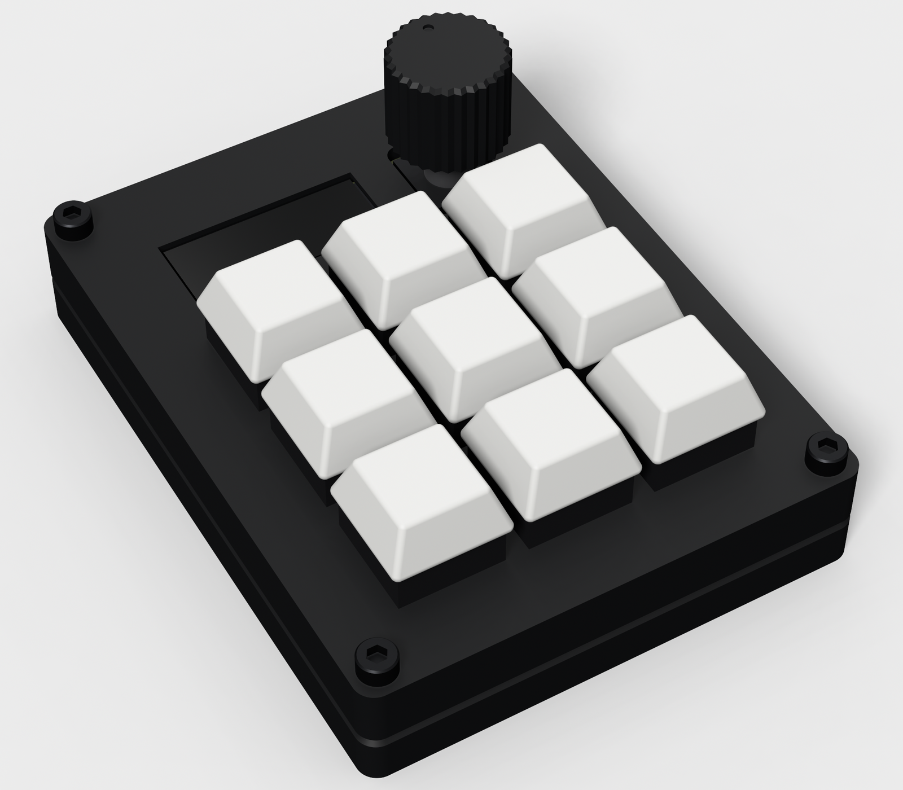

# Frostbite

Frostbite is a 9-key macropad with an OLED and a dial. It shows what my Claude Code sessions and ML training runs are
doing, and lets me answer them without switching windows.

I made it because I run a lot of agents at once and want one place to check on them.

The top six keys each pick a session, and the dial scrolls through them. The OLED shows each one's status. The bottom
row is Approve, Talk and Stop. A small Python script in `host/` connects the pad to my laptop.

## CAD Model

Everything is printed in black: a flat Top plate, a Bottom tray, a small OLEDSupport and the Knob. Four M3 screws go
through the plate into heat-set inserts in the Bottom. The case is 75.15 × 97.15 × 17.4 mm, modelled in CadQuery.

## PCB

A 2-layer board, 61.15 × 83.15 mm, with the XIAO RP2040 on the underside.

## Firmware Overview

The firmware is [QMK](https://qmk.fm/).

- The six session keys send F13-F18 on their own, and select a session when the script is running.
- Approve is F19, Talk is F20 and Stop is Escape.
- The dial changes volume on its own, and picks a session when the script is running.
- The OLED shows the selected session and the status of all six.

Pin map and flashing steps are in [Firmware/README.md](Firmware/README.md).

## BOM

Everything comes from the Hackpad kit except the PCB and the printed case. Links and prices are in [BOM.csv](BOM.csv).

| Part | Qty | From |
|---|---|---|
| Seeed XIAO RP2040 | 1 | Kit |
| MX-style switches | 9 | Kit |
| White DSA keycaps | 9 | Kit |
| 1N4148 diodes | 9 | Kit |
| EC11E rotary encoder | 1 | Kit |
| 0.91" OLED | 1 | Kit |
| M3×16 screws | 4 | Kit |
| M3 heat-set inserts | 4 | Kit |
| PCB | 1 | JLCPCB |
| Printed case and knob | 1 | Printing Legion |

## Credits

The layout is based on [Stratum](https://github.com/ReuTheCoder/stratum-macropad). I used Claude Code to help build
this project.
