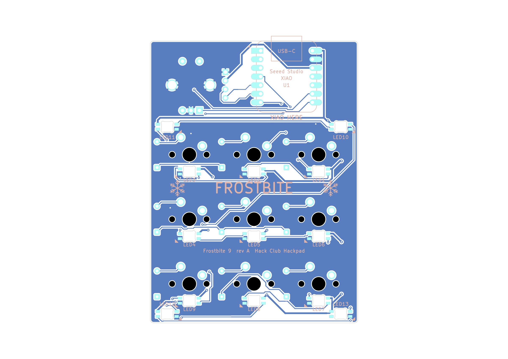

# Building Frostbite

The step-by-step build guide for Frostbite 9, written for someone who has never soldered before.
Hack Club's own `/assembly` page is an unfinished stub (`docs/audit/hackpad-rules.md:20`), so use this guide instead.

**Nobody has built this board yet.** Every check so far was done on files, not on hardware
(`docs/audit/electrical.md:3`, `README.md:236`). Stop at the first failure and fix it before you go on
(`docs/VERIFICATION.md:149`).

Three kinds of statement appear here:

- Project facts come from this repo. Each section ends with a **Source** line, as `file:line`.
- Advice marked *(general practice)* is ordinary soldering technique that the repo does not cover.
- Temperatures appear only with a linked source. The repo gives no number for some things, and this guide says so.

**Read section 16, "Conflicts found", before you start.** Where the repo's files disagree, the steps below are written
one way so that they read in order. That is not a ruling. A note like *(conflict 4)* marks each such step.

## Contents

1. [Words used in this guide](#1-words-used-in-this-guide)
2. [Tools](#2-tools)
3. [Parts check against the kit](#3-parts-check-against-the-kit)
4. [Lessons from other builds](#4-lessons-from-other-builds)
5. [Test pieces and measurements](#5-test-pieces-and-measurements)
6. [Heat-set inserts](#6-heat-set-inserts)
7. [Soldering order](#7-soldering-order)
8. [Multimeter checks before first power](#8-multimeter-checks-before-first-power)
9. [Flashing led-test.uf2](#9-flashing-led-testuf2)
10. [Finding a dead LED](#10-finding-a-dead-led)
11. [Needs real parts: measure and adjust](#11-needs-real-parts-measure-and-adjust)
12. [Flashing firmware.uf2](#12-flashing-firmwareuf2)
13. [Final assembly](#13-final-assembly)
14. [Troubleshooting](#14-troubleshooting)
15. [Laptop companion](#15-laptop-companion)
16. [Conflicts found](#16-conflicts-found)
17. [External sources](#17-external-sources)

## 1. Words used in this guide

| Word | Meaning |
|---|---|
| Top side | The side the switches, diodes, encoder and OLED sit on. It says `FROSTBITE` and `XIAO ON BACK`. |
| Underside | The side the XIAO and all 13 LEDs solder to. It says `XIAO HERE`. |
| Back edge | The edge with the USB-C connector. |
| Front edge | The edge nearest you when you use the pad. |
| Joint | One solder connection. |
| Tail | The piece of a wire lead sticking out past a joint. |
| Pad | The bare metal patch on the board that you solder to. |
| Short | Two things connected that should not be. |
| Chain | The 13 LEDs in a line. Each LED passes data to the next. |

**Left and right swap when you turn the board over.** This guide always says which view it means. Keep the back edge
away from you (at the top) in both views.

Underside view, USB at the top ([full plot](../PCB/images/pcb_back.png)):



XIAO pins seen from the underside, USB at the top:

| Left column | Net | | Right column | Net |
|---|---|---|---|---|
| D0 | ROW0 | | 5V | +5V |
| D1 | ROW1 | | GND | GND |
| D2 | ROW2 | | 3V3 | +3V3 |
| D3 | COL0 | | D10 | COL2 |
| D4 | SDA | | D9 | COL1 |
| D5 | SCL | | D8 | ENC_B |
| D6 | LED_DIN | | D7 | ENC_A |

**Source:** `design.json:2`, `design.json:16-75`, `docs/audit/electrical.md:26-47`, `PCB/README.md:165-178`.

## 2. Tools

The repo calls for these by name:

| Tool | Used for | Source |
|---|---|---|
| Multimeter with continuity and diode modes | Every check in section 8 | `docs/VERIFICATION.md:150` |
| Calipers | OLED, insert, keycap, encoder and printed pitch | `CAD/README.md:92`, `docs/VERIFICATION.md:54` |
| Needle file | A tight LED cut-out, or an encoder barb that will not pass | `docs/audit/pcb-physical.md:77`, `docs/audit/electrical.md:162` |
| Soldering iron with a tip for heat-set inserts | Inserts | `CAD/README.md:96` |
| USB-C cable that carries data | Everything after first power. A charge-only cable will not work. | `docs/BOM.md:34` |
| Switch puller | Only if the PCB must come out later | `CAD/README.md:110` |
| 4 stick-on feet | Last step *(conflict 11)* | `CAD/README.md:108` |

Also get these *(general practice)*:

- A temperature-controlled iron with a fine tip. A long, slim tip helps at the switch joints.
- Thin rosin-core solder. Adafruit calls 60/40 leaded solder the easiest to work with.
- Flux, solder wick and a tip cleaner.
- Fine tweezers. The LED datasheet says to pick parts up with tweezers and not to press on the lens.
- Flush cutters and safety glasses, because cut tails fly.
- A magnifier and a way to hold the board still.
- A driver that fits the kit's M3 screws. The shaft must reach down a 5.8 mm hole, up to 4.2 mm deep.

Safety: work with ventilation, wash your hands after handling leaded solder, and put the iron in its stand every time
*(general practice)*. The datasheet warns that SK6812s can be damaged by static and are bright enough to hurt your eyes,
so use anti-static precautions and do not stare at them.

**Iron temperature.** The repo gives no iron temperature. Adafruit's soldering guide says to set
[370 °C for 60/40 or 400 °C for lead-free](https://learn.adafruit.com/adafruit-guide-excellent-soldering).
The LED datasheet gives no hand-soldering figure. Its only related test is
[260 °C for 10 s, 3 times](https://cdn-shop.adafruit.com/product-files/4960/4960_SK6812MINI-E_REV02_EN.pdf) (p.12).
So keep each LED touch short, and let a joint cool before you try it again.

**Source:** `docs/audit/pcb-physical.md:36`, `docs/audit/case.md:122`, [SK6812 MINI-E datasheet](https://cdn-shop.adafruit.com/product-files/4960/4960_SK6812MINI-E_REV02_EN.pdf) pp. 12, 17, 18.

## 3. Parts check against the kit

Count everything before you heat anything.

| Kit part | In kit | Used | Spare | Check |
|---|---:|---:|---:|---|
| Seeed XIAO RP2040 | 1 | 1 | 0 | No spare, so take care. |
| Gateron Yellow KS-3 switches | 16 | 9 | 7 | 5-pin: 2 metal pins, 2 side pegs, 1 centre post. Pins straight. |
| White blank DSA keycaps | 16 | 3 | 13 | For Approve, Talk, Stop. |
| 1N4148 diodes | 20 | 9 | 11 | Black band at one end. |
| Alps EC11E encoders | 2 | 1 | 1 | Check the shaft has a D-flat. |
| 0.91" OLED | 1 | 1 | 0 | Read the pin labels now. See below. |
| SK6812 MINI-E LEDs | 16 | 13 | 3 | Only 3 spares. Handle gently. |
| M3 × 16 screws | 6 | 4 | 2 | |
| M3 heat-set inserts | 6 | 4 | 2 | OD 5, length 4. |

You must also have, from outside the kit:

| Item | Qty | Note |
|---|---:|---|
| PCB, 61.15 × 83.15 mm | 1 | From `production/gerbers.zip`. You get 5, so you have 4 for practice. |
| Top, Bottom, GlowBand | 1 each | Top and Bottom iced PETG, GlowBand clear or natural PETG. Ask the printer about material first. Printing Legion promises none. |
| Frosted translucent MX keycaps | 6 | For agent keys 1-6. Kit caps are opaque, so colours would not show. *(conflict 18)* |
| Knob, 18 mm, 6 mm D-shaft | 1 | Buy, or print `production/Knob.stl`. |
| 4-pin header for the OLED | 1 | Not in the kit table. Check whether your module has one. *(conflict 12)* |

Check these on the real parts:

1. **OLED labels.** Hold the module display side up with the header end on your right. From back to front the pins
   should read `GND`, `VCC`, `SCL`, `SDA`, matching the silkscreen beside J1. Some clones swap GND and VCC, and a swap
   would reverse-power the module. If yours differs, stop. The repo has no fix for a swapped module.
2. **OLED header.** Note whether it comes fitted, the pin length and what sits on the back of the module. None of this
   has been measured (`docs/audit/pcb-physical.md:177`).
3. **PCB markings.** Find `XIAO HERE`, four `LENS OUT` marks, the two-line LED legend and `GND VCC SCL SDA` beside J1.
   Check the small triangle at LED11 is readable, since it sits close to a pad and may be trimmed.
4. **LED fit.** On a spare PCB, drop one LED into a cut-out. If it binds, ease the cut-out with a needle file.

**Source:** `docs/BOM.md:8-69`, `PCB/README.md:88-96`, `PCB/README.md:156-163`, `docs/audit/pcb-physical.md:54`, `docs/audit/pcb-physical.md:72-77`, `docs/audit/hackpad-rules.md:209-212`.

## 4. Lessons from other builds

These are real failures on other Hackpads. Each one shaped a step below.

| What went wrong | What to do here |
|---|---|
| A first-time solderer could not fit the LEDs, **pulled up a trace** and shipped with no RGB. | Practise first (below). Never pull a part that is still held by solder. Frostbite has 13 LEDs on small pads (0.82 × 1.25 mm), thin 0.2 mm signal tracks and only 3 spares. |
| An encoder went on the wrong side, and a leg snapped off during removal. Only the kit's spare saved the build. | Fit the encoder from the top side and check twice before you solder. |
| A diode went in backwards and the builder had no tools to fix it. | Check the band on every diode before soldering. Have wick ready. |
| Firmware compiled but had never met hardware, and was replaced a month later. | Frostbite is the same so far. Treat the `led-test.uf2` results as real news. |
| LED power needed rework after the build. | Run the LED data checks in section 11 before you go further. |
| Prints did not fit first time, and measurements were the regret. | Do section 5 before you commit to a print. |
| One builder's USB port position was regretted. | Check a cable fits the case window before closing it. |

**Practise before you touch the real board.** You have 4 spare PCBs and 11 spare diodes. Solder diodes on a spare board
until your joints look smooth and shiny. Then practise tacking a small part on spare LED pads. Spare LEDs are few, so do
not use them all (a judgement call based on `docs/audit/hackpad-rules.md:196`).

**How to avoid ripping a trace** *(general practice)*:

- If a joint needs fixing, add flux and reheat. Do not press or lever the part.
- To remove a part, melt all its joints first, with wick or by alternating the iron. Lift only when it moves freely.
- Never hold the iron on one pad for a long time. Stop, cool, and try again with more flux.

**Source:** `docs/audit/hackpad-rules.md:193-207`.

## 5. Test pieces and measurements

Do this before you print the full set, if your printer allows it *(conflict 14)*.

1. Print a plate corner, a band/pad/skirt corner and the knob.
2. Print a cutout test. If switches are too tight, the fix is 0.05 hole/XY compensation in the slicer.
3. Press a real switch into the plate corner.
4. Try the printed knob on a real encoder shaft. Its fit is untested. Ream the D-bore if it is too tight.
5. Do the OLED measurement in [section 11](#oled-ribbon-clearance).
6. When you have the full Top, measure SW1 to SW3 centre to centre. It should be 38.10 mm. Shrink above about 0.26 % loads
   the switch posts.
7. The glow corner needs a lit LED, so test it when LED10 is working ([section 11](#glow-brightness)).

Print settings: PETG, 0.4 mm nozzle, [240 °C, bed 80 °C](../CAD/README.md#print-settings), 4 perimeters, 25 % gyroid,
no supports. GlowBand uses 100 % infill or 6 perimeters.

**Source:** `CAD/README.md:29`, `CAD/README.md:61`, `CAD/README.md:73-82`, `CAD/README.md:92`, `docs/audit/case.md:117`.

## 6. Heat-set inserts

**When:** before the PCB goes anywhere near the Top. The repo does this right after printing.

**Which side:** the four holes open at the skirt rim, in the side walls of the Top. Stand the Top skirt-up so the holes
face you. The Bottom and GlowBand get no inserts.

**Temperature:** `CAD/README.md:96` says about 230 °C. CNC Kitchen says to go 10-20 °C above print temperature and gives
[245 °C for PETG](https://cnckitchen.com/blog/tips-and-tricks-for-heat-set-inserts). These differ *(conflict 20)*.
Practise on a test piece with a spare insert, using the cooler setting first. Go hotter only if the insert will not sink under light pressure.

Steps:

1. Sit the Top skirt-up on a flat surface.
2. Set one insert on a hole. It should sit straight. Try the first one on a test piece if you printed one.
3. Put the hot tip into the insert and press lightly. Let it sink under heat. Do not push hard.
4. CNC Kitchen's advice: melt it in about 90 % of the way, then finish with a flat tool.
5. Press it flush with the rim and hold it still for a moment so it does not creep back.
6. Keep the iron off the rim and walls. The wall around each insert is only about 2 mm thick.
7. Repeat for all four.
8. After cooling, run an M3 screw in by hand. It should go straight.

The hole is 4.7 mm, as Hack Club's guide says, which is wider than ruthex's 4.4 mm. Expect an easy fit. There is 8.8 mm of
clearance hole beyond each insert, so displaced plastic has somewhere to go.

**Source:** `CAD/README.md:96`, `CAD/README.md:122`, `docs/DIMENSIONS.md:16`, `docs/audit/case.md:205`, `docs/VERIFICATION.md:156`.

## 7. Soldering order

| Stage | Part | Why it comes here |
|---|---|---|
| A | Bare board check | Finds a board fault before parts hide it. |
| B | XIAO | Every later test needs it. Flashing needs nothing else. |
| C | First flash | Proves USB and the XIAO before you add 13 LEDs. |
| D | LED1 alone | LED1 is the one LED that sees 3.3 V data. If it fails, all 13 fail. |
| E | LED2 to LED9 | The chain feeds the glow LEDs, so these must work first. |
| F | LED10, tested, then LED11 to LED13 | One test catches a wrong fit before you repeat it three times. |
| G | Diodes | Lie flat, low parts first, before anything tall. |
| H | Encoder | Tall. Goes in before the switches. |
| I | Trim tails | The GlowBand sits 0.6 mm below a 2.0 mm tail. |
| J | OLED header | Module solders to its header now. J1 waits. |
| K | Switches and J1 | The PCB can only enter the Top with the switches. |

The XIAO goes first in every repo order (`docs/VERIFICATION.md:151`, `CAD/README.md:97`, `docs/audit/pcb-physical.md:132`,
`docs/audit/case.md:190`). The order of the LEDs and the OLED differs *(conflicts 2 and 4)*.

### Stage A: bare board

1. Do [check A](#check-a-bare-board) on the PCB you will use.

### Stage B: XIAO, castellated, on the underside

Why flat: it is soldered by its edge pads, so no pins poke up under the OLED.

1. Turn the board underside up. Find `XIAO HERE`.
2. Lay the XIAO flat on that outline with **its components facing you, away from the PCB**.
3. Point USB-C at the back edge. Line up the XIAO board edge with the PCB edge *(conflict 13)*.
4. Check the 14 XIAO edge pads sit over the 14 PCB pads, 7 per side.
5. Tack one corner. Check the XIAO is flat and square. Then tack the opposite corner.
6. Solder all 14 pins. Touch the iron to the exposed PCB pad at the XIAO's edge and feed solder.
7. If a pin is hard to reach, the repo gives a second method: from the top side, heat the pad and feed solder down the
   plated hole. This only works before the OLED is on.
8. Take extra care with the GND pin, second from the USB end. It is the XIAO's only GND link, so a bad joint takes out the
   LEDs, OLED and keys together.
9. Do not leave solder blobs under the XIAO.

Fitting it on the top side would mirror the pinout and put 5V onto D0. That is why the top side says `XIAO ON BACK`.

### Stage C: first flash

1. Do [check B](#check-b-after-the-xiao).
2. Do [the first flash](#first-flash-on-a-blank-xiao).

### Stage D: LED1 alone

**Fit for LED1 to LED9:** lens **into** the hole, back of the part facing you. Light goes up into the switch.

The lens is the side with the ring. The back has a rib and a small round mark.

1. Unplug USB.
2. Find LED1 on the underside. It is under SW1.
3. Tin one pad lightly. Use the pad beside the triangle.
4. Hold the LED with tweezers. Drop the body into the cut-out, **back facing you**.
5. Put the chamfered lead on the triangle pad. The triangle marks GND, pad 3.
6. Reheat that pad until the lead sinks in. Keep it short.
7. Check all four leads sit on their pads. Then solder the other three.
8. Do [check C](#check-c-after-each-led), then the [LED1 test](#led1-test).

### Stage E: LED2 to LED9

1. Fit one LED the same way. Lens into the hole, chamfer on the triangle.
2. Unplug, do check C, plug in, and confirm it lights in turn.
3. Repeat in chain order. Testing as you go means a fault can only be the LED you just fitted.

### Stage F: flipped glow LEDs

**Fit for LED10 to LED13: flipped. Lens OUT, facing you, back of the part in the hole.** Light goes down into the glow
band. Look for the `LENS OUT` text and the ring-and-dot mark beside each one. The legend mid-board says
`LED1-9: LENS INTO HOLE` and `LED10-13 FLIPPED: LENS OUT`.

Nothing physically stops a wrong fit, because the cut-out takes either face. After nine LEDs, your hands will want to do the same again.

1. Stop and read the marks at LED10.
2. Put the ring-side lens toward you and the back into the hole.
3. Put the chamfered lead on the triangle. **Both must be true: lens out and chamfer on triangle.**
4. If you cannot get both at once, the part is the wrong way up. Stop and turn it over.
5. Solder LED10 the same way as the others.
6. Do check C, then run `led-test.uf2`. LED10 must light, facing you.
7. Only then fit LED11, LED12 and LED13, testing each.

**What goes wrong if fitted like the others.** The repo's account: VDD and GND still land correctly, but the data pins
swap. LED10's DOUT fights LED9's DOUT on `LED_D9`, the glow chain gets no data, and the light goes up into the board. Key LEDs
still work, so the fault only shows at the very end of bring-up.

Another file says a flipped LED cannot line its chamfered lead up with the mark, and the board's pad positions support
that *(conflict 1)*. All files agree on the outcome: the glow chain stays dark. Do not leave a suspect glow LED powered.
Unplug and fix it.

Check where they go, seen from the underside with USB at the top:

| LED | Corner, underside view |
|---|---|
| LED10 | Back right |
| LED11 | Back left |
| LED12 | Front left |
| LED13 | Front right |

### Stage G: diodes, band toward the front edge

Why now: they lie flat and are easy to reach. The plate sits 2.5 mm above the PCB, so a raised diode would hit it.

1. Top side up, back edge away from you.
2. Find D1. Each diode sits to the right of its switch. The square pad is marked `K`.
3. Bend the leads to fit the holes, 7.62 mm apart.
4. Put the **black band on the `K` end**. On all nine diodes that is the end **nearest the front edge**.
5. Check the band against the silkscreen on this diode before you solder it.
6. Press it flat onto the board. It must end up at most 2.2 mm tall.
7. Turn the board over and solder both leads.
8. Do the first diode, then check it with [check D](#check-d-after-the-diodes) before you do all nine.

The band points at the row: cathode to the row, `COL2ROW`. A backward diode means a dead key.

### Stage H: encoder

1. Fit it from the **top side**. Check this twice. The body sits on the same side as the diodes.
2. Turn it so the three-pin row (A, C, B) faces the keys and the two-pin row faces the back edge.
3. Press straight down until the side lugs snap through their slots. Expect a firm press.
4. If a barb will not pass, file it. Do not force it, because that puts the plated hole at risk. Lug figures come from
   Alps' model, and a kit clone may differ.
5. Check it sits flat and square.
6. Turn the board over. Solder the three pins, the two lugs and the two pins of the unused push switch *(general practice: the push switch has no signal, but the joints add strength)*.
7. The lugs and pin C go to GND and need a little longer to heat.

### Stage I: trim tails

1. On the underside, cut all through-hole tails (diodes, encoder) to **2.0 mm or less**.
2. Do [check E](#check-e-after-the-encoder-and-tails).

### Stage J: OLED header

Why now: the header must be on the module before the PCB goes into the Top. The 38 mm module cannot pass the 30.6 mm
window, and the PCB blocks the other way in. Do the [OLED measurement](#oled-ribbon-clearance) first if you have not.

1. Compare the module's labels with the silkscreen once more.
2. The black plastic header strip goes **between** the module and the PCB, keeping a 2.5 mm gap. The display faces up.
3. Put the long pins into J1 to hold them square *(general practice)*. **Do not solder J1 yet.**
4. Set the module on the header, display up, header at the right-hand end.
5. Solder the four pins on the module.
6. Lift it off. Trim the pins **flush on the module's top side** with flush cutters.
7. Measure the joints. The lip above them leaves about 0.3 mm, and domed joints may not fit even when trimmed.
8. Sit the header in J1 on the PCB, **unsoldered**.

### Stage K: switches, then J1

The PCB cannot be fitted or removed without the switches. It goes in from the skirt side and the switches are soldered
through it *(conflict 5)*. BOOT stays reachable from the open skirt until the case closes ([why that matters](#bootloader-access)).

1. Clip all 9 switches into the plate **from the top face**. Press until the clips seat.
2. Check every switch pin is straight.
3. Turn the Top upside down on a surface that does not press on the switches.
4. Hold the OLED in J1. Lower the PCB **straight down** the skirt, underside facing you, onto the switch pins.
5. Watch for four things: USB goes through the notch, the encoder goes through its opening, the OLED glass enters the
   window, and every switch pin comes through.
6. Do not force it. Lift out and look for a bent pin.
7. Solder the 18 switch joints from underneath (2 per switch).
8. **How the iron reaches:** the PCB underside sits 9.4 mm below the skirt rim. The closest switch pin is about 8 mm from
   the wall, so lean the iron about 40 degrees at the rim. That is a normal angle. Keep the hot shaft off the printed wall.
9. Take care at SW3 pin 2. It is the closest joint to any LED, right beside LED11's GND pad. Use a small amount of solder
   and check for a bridge.
10. Solder the 4 J1 pins last, from underneath, so the module lines itself up with the window. Hold it level. The header
    is its only support.
11. Trim J1 and any switch tails to 2.0 mm or less *(conflict 21)*.
12. Do [check F](#check-f-after-the-switches-and-j1).

The PCB now hangs from the 9 switches. Nothing rests under it, and that is by design.

**Source:** `PCB/README.md:79-96`, `PCB/README.md:112-122`, `PCB/README.md:140-163`, `PCB/README.md:175-188`, `CAD/README.md:53`, `CAD/README.md:56`, `CAD/README.md:86-110`, `CAD/README.md:136-137`, `docs/BOM.md:12-18`, `docs/audit/electrical.md:62`, `docs/audit/electrical.md:143`, `docs/audit/electrical.md:162`, `docs/audit/electrical.md:172`, `docs/audit/case.md:160`, `docs/audit/case.md:203`, `docs/audit/pcb-physical.md:28`, `docs/audit/pcb-physical.md:53`, `docs/audit/pcb-physical.md:70`, `docs/audit/pcb-physical.md:129`, `PCB/tools/gen_pcb.py:238-239`.

## 8. Multimeter checks before first power

**USB unplugged for every continuity check.** A steady tone between two points means they are connected.

A short chirp that fades can be a capacitor charging. A steady tone means a short *(general practice)*. With parts
fitted, a meter may also show a resistance value, which is fine so long as it is not near zero.

If a "must not beep" check beeps, **do not plug in**. Look for a solder bridge, clean it with wick, then test again.

### Check A: bare board

| Probe between | Expect |
|---|---|
| 5V pad and GND pad | No tone |
| 3V3 pad and GND pad | No tone |
| 5V pad and 3V3 pad | No tone |
| D0 and D1, D1 and D2 (rows) | No tone |
| D3 and D9, D9 and D10 (columns) | No tone |

### Check B: after the XIAO

| Probe between | Expect |
|---|---|
| **5V and GND** | **No steady tone. This is the check that matters most.** |
| **3V3 and GND** | **No steady tone** |
| 5V and 3V3 | No steady tone |
| Each XIAO pin and the next pin down, both columns | No tone |
| XIAO GND and J1 pin 1 | Tone |
| XIAO 3V3 and J1 pin 2 | Tone |
| XIAO 5V and LED1 pad 1 | Tone |

Pad 13 is the GND check above. A silent reading there means the XIAO's only GND joint is bad.

### Check C: after each LED

| Probe between | Expect |
|---|---|
| **5V and GND** | **No steady tone** |
| LED pad 1 and pad 2 | No tone |
| LED pad 3 and pad 4 | No tone |

The two pads on each side of an LED are only 0.68 mm apart, so they are the likely bridges.

### Check D: after the diodes

1. Set the meter to diode mode.
2. Put the red probe on the anode end and black on the `K` end. You should get a reading.
3. Swap the probes. You should get no reading.
4. If it reads the wrong way round, the diode is backwards. Fix it now.
5. Repeat the row and column checks from check A.

### Check E: after the encoder and tails

| Probe between | Expect |
|---|---|
| 5V and GND | No steady tone |
| ENC1 pin A and GND | No tone |
| ENC1 pin B and GND | No tone |
| ENC1 pin C and GND | Tone |
| D0 to D10, each against GND | No tone |

Measure the tails. Any tail over 2.0 mm gets cut.

### Check F: after the switches and J1

| Probe between | Expect |
|---|---|
| **5V and GND** | **No steady tone** |
| **3V3 and GND** | **No steady tone** |
| SDA and SCL | No tone |
| SW3 pin 2 and LED11 pad 3 | No tone |

Then press each key while you probe its row and column. It should only connect with the key held down, and through a diode.

### First voltage reading

The first time you plug in, set the meter to DC volts:

| Probe between | Expect |
|---|---|
| 5V and GND | About 5 V. This is raw USB power. Write it down for section 11. |
| 3V3 and GND | About 3.3 V |

**Source:** `docs/VERIFICATION.md:150`, `docs/audit/electrical.md:32-47`, `docs/audit/electrical.md:70`, `docs/audit/electrical.md:86`, `docs/audit/electrical.md:106`, `docs/audit/pcb-physical.md:53`.

## 9. Flashing led-test.uf2

`production/led-test.uf2` is the test program. Run it **before** the case closes.

### Bootloader access

BOOT and RESET sit on the XIAO's component side, at the end away from USB. Once the case is closed they face the sealed
chamber, and there is no access hole. Reaching them means taking out the 4 screws. Only the Approve + Stop combo works with
the case closed, and only if the matrix and firmware are good.

Seeed's wiki calls these buttons B and R.

### First flash on a blank XIAO

**Use the BOOT button for this one.** The double-tap and the Approve + Stop combo are both part of the Frostbite firmware
(`config.h:5-7`, `frostbite.c:5-11`), so they cannot work until Frostbite firmware is on the XIAO. Neither the repo nor
Seeed's wiki says what program a new XIAO ships with, so assume nothing.

1. Unplug the XIAO.
2. Press and hold **BOOT**.
3. Plug the USB-C cable into the laptop while you hold it.
4. Let go.
5. A drive named **RPI-RP2** appears.
6. Drag `production/led-test.uf2` onto it.
7. The board reboots by itself and the drive goes away.

Check the laptop sees it, from the repo root:

```sh
cd host && uv run python -c "from frostbite_host.device import HidTransport; print(HidTransport.find())"
```

A non-empty list means the pad is running Frostbite firmware.

### What the first flash results mean

| Result | Meaning | Next |
|---|---|---|
| RPI-RP2 appears, flash works, the check lists a device | USB, XIAO and power are good | Go to Stage D |
| RPI-RP2 does not appear | Charge-only cable, or BOOT was released too early | Try a data cable, and hold BOOT longer |
| Laptop reports a USB problem, or the XIAO gets hot | Possible short | Unplug at once. Redo check B. |
| RPI-RP2 appears, but no device afterwards | Drag failed, or the file is wrong | Flash again and check the file name |

### LED1 test

With only LED1 fitted, it lights red, green, blue, white, then **stays dark for about 17 seconds**. That is normal: the test
runs through all 13 positions whether the LEDs exist or not. Each LED gets 1.4 s (4 colours at 350 ms), so a full pass takes
18.2 s.

| Result | Meaning | Next |
|---|---|---|
| Red, green, blue, white, steady | LED1 and data are good | Go on |
| Never lights | Bad joint, wrong way round, or data level too low | See section 10, then section 11 |
| Flickers or shows random colours | 3.3 V data is marginal | Section 11, [LED data level](#led-data-level) |
| Colours in the wrong order, such as green during the red step | Colour order fault | A firmware fault, not soldering. Note it. |

### Full led-test results

The OLED shows this once J1 is soldered. Before that, use the timing above.

```
LED TEST 5/13
colour: green
key: r1 c2
knob: 3
```

The test still runs with no OLED fitted.

| LED | Chain position | Location, top view | Lights after LED1 |
|---|---:|---|---:|
| LED1 | 1 | Under SW1, Agent 1 | 0 s |
| LED2 | 2 | Under SW2, Agent 2 | 1.4 s |
| LED3 | 3 | Under SW3, Agent 3 | 2.8 s |
| LED4 | 4 | Under SW6, Agent 6 | 4.2 s |
| LED5 | 5 | Under SW5, Agent 5 | 5.6 s |
| LED6 | 6 | Under SW4, Agent 4 | 7.0 s |
| LED7 | 7 | Under SW7, Approve | 8.4 s |
| LED8 | 8 | Under SW8, Talk | 9.8 s |
| LED9 | 9 | Under SW9, Stop | 11.2 s |
| LED10 | 10 | Glow, back left | 12.6 s |
| LED11 | 11 | Glow, back right | 14.0 s |
| LED12 | 12 | Glow, front right | 15.4 s |
| LED13 | 13 | Glow, front left | 16.8 s |

The middle row runs right to left, so the order zig-zags. That is correct.

After the switches are in, each key should show once:

| Key | OLED shows | | Key | OLED shows | | Key | OLED shows |
|---|---|---|---|---|---|---|---|
| Agent 1 | `r0 c0` | | Agent 2 | `r0 c1` | | Agent 3 | `r0 c2` |
| Agent 4 | `r1 c0` | | Agent 5 | `r1 c1` | | Agent 6 | `r1 c2` |
| Approve | `r2 c0` | | Talk | `r2 c1` | | Stop | `r2 c2` |

Keys send their fallback codes during this test, so Stop sends Escape to the laptop. The test build also reads the knob, and turning it changes `knob:` without changing the volume.

**Source:** `Firmware/README.md:30-43`, `Firmware/README.md:60-72`, `Firmware/qmk/keyboards/frostbite/keymaps/ledtest/keymap.c:1-75`, `Firmware/qmk/keyboards/frostbite/config.h:5-7`, `Firmware/qmk/keyboards/frostbite/frostbite.c:5-11`, `docs/audit/case.md:110`, `docs/audit/electrical.md:203-205`, `docs/audit/firmware.md:224`, `docs/VERIFICATION.md:152`, `host/README.md:28`, [Seeed XIAO RP2040 wiki](https://wiki.seeedstudio.com/XIAO-RP2040/).

## 10. Finding a dead LED

**What it looks like.** Each LED rebuilds the data signal for the next one. So one bad LED or joint usually darkens itself
**and every LED after it**, while the OLED keeps counting up through the dark ones. LEDs before the fault work normally.

If LED n works and LED n+1 never lights, the fault is in LED n's DOUT, LED n+1's DIN, or LED n+1's 5V or GND.

Pad numbers: 1 = 5V, 2 = DOUT, 3 = GND (triangle), 4 = DIN.

1. Note the last LED that works. Call it n.
2. Unplug USB.
3. Look at both LEDs under a magnifier. Check the leads sit on their pads and the fit is right for that LED.
4. Check continuity from LED n pad 2 to LED n+1 pad 4. Expect a tone.
5. Check LED n+1 pad 3 to XIAO GND. Expect a tone.
6. Check LED n+1 pad 1 to XIAO 5V. Expect a tone.
7. Plug in. Measure LED n+1 pad 1 to pad 3 in DC volts. Expect about 5 V.
8. Reflow any doubtful joint with flux.
9. If the wiring is good and it stays dark, replace LED n+1. You have 3 spares.
10. If the replacement stays dark too, replace LED n, since its DOUT may be dead.

**Removing an LED without ripping a trace** *(general practice)*:

1. Add flux and fresh solder to all four joints.
2. Heat one side's two leads and then the other's, or use wick to clear each side.
3. Lift only when the part moves on its own.
4. Clean the pads with wick, gently. Do not scrub.

Single-LED faults that do not affect the chain:

| Symptom | Likely cause |
|---|---|
| One colour missing on one LED | A damaged LED. Replace it. |
| LED works but looks dim through the switch | Lens position against the switch window. This is an open question and affects brightness only. |
| Key LEDs fine, all glow LEDs dark | LED10 fitted wrong. See Stage F. |

**Source:** `Firmware/README.md:40-42`, `Firmware/qmk/keyboards/frostbite/keymaps/ledtest/keymap.c:6-7`, `PCB/README.md:175`, `docs/audit/electrical.md:62`, `docs/audit/electrical.md:166`, `docs/audit/electrical.md:207-213`.

## 11. Needs real parts: measure and adjust

The verifier's report lists five things no file check can prove (`verify/REPORT.md:9-17`). Only you can settle them.

| Item | When | Setting to change |
|---|---|---|
| OLED flip | After J1 is soldered | `FROSTBITE_OLED_FLIP` in `config.h:30` |
| EC11 resolution | After J1 is soldered | `encoder.rotary[0].resolution` in `keyboard.json:30` |
| LED data level | Stage D and after Stage F | **No setting exists** |
| OLED ribbon clearance | Before the full print | `oled.window` in `design.json:235`, then reprint the Top |
| Glow brightness | When LED10 works | `GLOW_DEFAULT_BRI` in `keymap.c:91`, and `glow()` in `state.py` when the daemon runs |

### OLED flip

1. Run `led-test.uf2` with J1 soldered.
2. Read the text. It should be upright with the back edge away from you.
3. Upright: change nothing.
4. Upside down: comment out one line in `Firmware/qmk/keyboards/frostbite/config.h`:

   ```c
   // #define FROSTBITE_OLED_FLIP
   ```

5. Rebuild both firmware files. See [Rebuilding](#rebuilding).

The flip is on now because four reference Hackpads with this header position use it. No Frostbite module has confirmed it.

### EC11 resolution

1. Run `led-test.uf2`, and watch `knob:` on the OLED.
2. Turn the knob **one click** and see how far the count moves.
3. Change `encoder.rotary[0].resolution` in `keyboard.json`. It is 4 now.

| You see | Do this |
|---|---|
| One click moves the count by 1 | Nothing |
| One click moves the count by 2 | Double the value |
| Two clicks are needed for one count | Set it to 2. This is expected on a true 30-detent/15-pulse EC11E. |

Direction is also open. Clockwise should count up. If it counts down, swap `pin_a` and `pin_b` in `keyboard.json`, and do not
resolder *(conflict 10)*.

### LED data level

**What is unknown:** the LEDs' datasheet asks for 3.5 V data at 5 V power, and the XIAO gives 3.3 V. Only LED1 sees this, but LED1 feeds all 13.
The data only meets the spec if VBUS falls to 4.71 V (3.3 / 0.7). This batch's real threshold is unmeasured.

1. Plug into your highest-voltage USB port. Measure 5V to GND on the XIAO and write it down.
2. Run `led-test.uf2` with LED1 alone. Watch for flicker or wrong colours.
3. Repeat with all 13 fitted. Every LED must step through its colours cleanly, with no flicker.
4. Try each USB port and cable you will use.

The report asks for the whole chain at full white, but no build here does that. `led-test` lights one LED at a time at level 90 of
255 *(conflict 7)*.

**There is no single setting for this.** It is not a firmware option. If the chain is unreliable, the repo's only remedy is
to feed LED1's VDD through a spare 1N4148, which drops it to about 4.3 V. The board has no footprint for that, so it means
cutting a trace *(conflict 8)*. Stop and get advice before you cut anything.

### OLED ribbon clearance

**What is unknown:** the ribbon and tape at the far end of the module may not fit under the printed lip. The lip leaves about
0.3 mm above the module board. This risk is open and has not been fixed.

Measure the kit module with calipers:

1. Module board thickness at a plain edge.
2. Thickness at the far end (the end away from the header), over the folded ribbon and tape.
3. Subtract: that is the ribbon height above the board.
4. Glass position from both ends of the module.
5. Header plastic height. The design assumes 2.5 mm.
6. Joint height after trimming, at the header end.

| Result | Meaning |
|---|---|
| Ribbon and joints under 0.3 mm | It fits as designed |
| Ribbon over 0.3 mm | Extend the window through the lip at that end, as both reference builds do |
| Joints over 0.3 mm | Thin the lip locally to 0.7 mm. This is a CAD change with no parameter. |

**Setting:** `oled.window` in `design.json:235`, using `x` and `w`, so the opening runs through the lip at the far end. Then
rerun `CAD/frostbite_case.py` and `CAD/check_fit.py`, and reprint the Top. That route has not been tried, and a window test may
need updating. Decide this before you print, since the Top goes to a stranger's printer.

### Glow brightness

**What is unknown:** whether the 2 mm band glows enough. The numbers so far are a model and an estimate. The estimate says
it is visible in a dim room and faint in a bright one, with hot spots near the LEDs and the back edge dimmest.

1. Get LED10 working, flipped, on the real board.
2. Flash `firmware.uf2` and run it with no daemon. The glow shows ice blue `#7fe3ff` at 70 of 255, about 27 %.
3. Hold the printed band/pad/skirt corner under LED10, the way it will sit in the case.
4. Look at it in a dim room and a bright room. Photograph it.
5. Flash `led-test.uf2` again before you carry on with the build.

To change it, set `GLOW_DEFAULT_BRI` in `keymap.c:91` and rebuild. With the daemon running, the host sets the glow instead:
`host/frostbite_host/state.py:430-431` uses 110 while something runs and 50 when nothing does *(conflict 15)*.

A limiter caps total LED output at 40 % of full scale, so more brightness will not always show. If it is still too dim, the
repo's next steps are foil or white paint on the skirt's inner wall, then moving light sources at the PCB level.

### Rebuilding

Any change above means a rebuild. You need QMK set up first ([QMK docs](https://docs.qmk.fm/newbs)). From `Firmware/`:

```sh
export PATH="$HOME/.local/bin:$HOME/Library/Application Support/qmk/bin:$PATH"
ln -sfn "$PWD/qmk/keyboards/frostbite" ~/qmk_firmware/keyboards/frostbite   # once
qmk lint    -kb frostbite
qmk compile -kb frostbite -km default
qmk compile -kb frostbite -km ledtest
cp ~/qmk_firmware/frostbite_default.uf2 ../production/firmware.uf2
cp ~/qmk_firmware/frostbite_ledtest.uf2 ../production/led-test.uf2
```

**Source:** `verify/REPORT.md:9-17`, `Firmware/README.md:18-28`, `Firmware/README.md:45-56`, `Firmware/README.md:75`, `CAD/README.md:56`, `CAD/README.md:59-71`, `docs/audit/electrical.md:116`, `docs/audit/electrical.md:164-172`, `docs/audit/firmware.md:71-86`, `docs/audit/firmware.md:124-132`, `docs/audit/case.md:81`, `docs/audit/case.md:89-100`, `docs/audit/case.md:108`, `docs/VERIFICATION.md:65-66`, `Firmware/qmk/keyboards/frostbite/keymaps/default/keymap.c:91`, `Firmware/qmk/keyboards/frostbite/keymaps/default/keymap.c:101`.

## 12. Flashing firmware.uf2

Do this after every key, the knob, the OLED and all 13 LEDs pass in `led-test.uf2`, **with the case still open** *(conflict 6)*.

1. Enter the bootloader. Frostbite firmware is on the XIAO now, so any of these works:
   - Double-tap **RESET**, or
   - Hold **BOOT** while plugging in, or
   - Hold **Approve + Stop** (bottom-left and bottom-right keys) while plugging in. This also clears EEPROM. Both keys are required.
2. Drag `production/firmware.uf2` onto **RPI-RP2**.
3. The board reboots by itself.

With no laptop app running you should see this:

- Agent LEDs dim white, command keys dim white.
- Glow LEDs ice blue.
- OLED row 4 shows the slot strip, ending in `KBD`.
- Keys send F13 to F20 and Escape. The knob changes volume.

Press every key and turn the knob while you can still reach BOOT. On macOS, F14 and F15 may change screen brightness
in fallback mode. That has not been tested and is not a fault.

**Source:** `Firmware/README.md:30-38`, `Firmware/README.md:58-75`, `Firmware/README.md:100-120`, `Firmware/qmk/keyboards/frostbite/frostbite.c:5-11`.

## 13. Final assembly

Do not start until sections 9, 11 and 12 pass. After this, BOOT and RESET mean removing 4 screws.

1. Measure tails one last time. All must be 2.0 mm or less.
2. With the Top still upside down, lower the **GlowBand** onto the skirt.
3. The riser and pads go into the pocket, and the tongue goes into the USB notch.
4. Check the band sits flat, with no gaps.
5. Lay the **Bottom** on the band.
6. Put the 4 M3 × 16 screws in from underneath.
7. Turn each one a little at a time, working in a cross pattern *(general practice)*.
8. Stop each one as soon as it is **snug**.
9. Press on the 3 white caps (Approve, Talk, Stop) and 6 frosted caps (agent keys).
10. Fit the knob, with the D-flat lined up.
11. Add 4 stick-on feet.
12. Plug in USB-C and check the plug seats fully.

**Screw torque.** The repo gives no torque number, so do not chase one. Its advice is to tighten until snug and no more,
because PETG creeps. Use a small hand driver, not a power driver *(general practice)*. Snug here means the head has
seated and the parts have closed up. The thread is in a metal insert with 4 mm of engagement, so an insert that spins or a
screw that suddenly gets loose means stop.

The screws sit nearer the back than the front (28 mm from the front skin, 16 mm from the back). If a part has warped, the band
gap opens at the front, where you will see it. Check this as you tighten. A screw that binds early is usually off its
thread, so back it out and start it straight.

Use the kit screws. A 16 mm screw stops 0.4 mm short of the blind end of its hole, so a longer one will not fit.

To take the PCB out later, release the 9 switches from the plate with a puller and lift it out with them, or desolder 18 joints.

**Source:** `CAD/README.md:94-110`, `docs/audit/case.md:113`, `docs/audit/case.md:206`, `docs/audit/case.md:178`, `docs/VERIFICATION.md:156`.

## 14. Troubleshooting

| Symptom | Likely cause | Fix |
|---|---|---|
| RPI-RP2 never appears | Charge-only cable, or BOOT released early | Use a data cable. Hold BOOT while plugging in. |
| Double-tap does nothing on a new XIAO | Double-tap is a Frostbite firmware feature | Use BOOT for the first flash |
| Approve + Stop does nothing | Firmware not on it, or keys or matrix not working | Use BOOT. Remove the 4 screws if closed. |
| Steady tone between 5V and GND | Solder bridge | Do not plug in. Check the last part you fitted, then the LEDs. |
| Everything dead after an LED is added | That LED or a bridge | Unplug. Do check C. |
| No LEDs light, OLED counts | LED1, or the D6 data joint | Section 10 |
| LEDs stop at one point | Fault at that LED or the next | Section 10 |
| Key LEDs fine, glow dark | LED10 wrong way up | Stage F |
| LEDs flicker | Marginal 3.3 V data | Section 11 |
| Glow visible only on the skirt or too dim | Light path | Section 11 |
| OLED blank | J1 joint, or VCC/GND order | Check SDA, SCL, VCC, GND. Compare labels with J1. |
| OLED text upside down | `FROSTBITE_OLED_FLIP` | Section 11 |
| OLED sits crooked or glass misses the window | J1 soldered off-level | Reflow J1 while holding the module level |
| Module will not seat under the lip | Ribbon or domed joints | Section 11 |
| One key dead | Bad switch joint, or diode backwards | Reflow. Do check D on that diode. |
| A row or column dead | XIAO pin joint on that row or column | Reflow that XIAO pin. Check its neighbour. |
| Pressing one key shows two | Bridge between row or column pins | Re-run the neighbour checks |
| Knob needs two clicks per step | `resolution` too high | Section 11 |
| Knob jumps two steps per click | `resolution` too low | Section 11 |
| Knob runs backwards | A and B order | Swap `pin_a` and `pin_b` |
| Knob too tight or loose | Untested print fit | Ream the bore, or use a bought knob |
| Switches too tight in the plate | Print tolerance | 0.05 hole/XY compensation in the slicer |
| PCB will not drop in | Bent switch pin | Lift out and straighten |
| GlowBand will not sit flat | Tail over 2.0 mm, or printing | Trim tails and check again |
| Band gap at the front | Warped part | Recheck the screws, without over-tightening |
| USB plug will not seat | Plug overmold too big | Cables up to about 13.4 × 7.9 mm should work |
| Pad falls back to `KBD` | No PING for 5 s | Check the daemon runs |
| OLED went dark | 10-minute burn-in protection | Press a key or turn the knob |
| OLED says `tap slot first` | Another tab or app is in front | Tap the agent key, then press Approve |
| OLED says `answer in terminal` | Session cannot be proved | Answer in the terminal. VS Code, Ghostty, WezTerm, Cursor, the desktop app, SSH and tmux always do this. |
| Approve refused every time | Automation permission missing | Section 15 |
| Laptop does not find the pad | Wrong cable, firmware not flashed, or no daemon | Run the check in section 9 |

**Source:** `Firmware/README.md:101`, `Firmware/README.md:117`, `host/README.md:115-146`, `CAD/README.md:79-82`, `docs/audit/case.md:177`, `docs/audit/electrical.md:185`.

## 15. Laptop companion

The pad works as a plain keyboard with nothing installed. The companion adds agent status and the Approve and Stop actions.

**Nothing here installs itself.** Steps marked **BY HAND** change your own laptop. No script does them for you, and nothing
in the project edits your settings.

### Install

1. **BY HAND.** Install the host tools from the repo root. This needs `uv`.

   ```sh
   uv tool install ./host
   ```

2. Try it with no pad. This prints every report it would send:

   ```sh
   frostbite-daemon --dry-run
   ```

3. Plug in the pad and check it is seen (run from `host/`):

   ```sh
   uv run python -c "from frostbite_host.device import HidTransport; print(HidTransport.find())"
   ```

4. Start the daemon:

   ```sh
   frostbite-daemon
   ```

5. Test it in a second terminal. Slot 3 should turn blue, then green, then clear:

   ```sh
   frostbite-ctl set 3 run "CI build"
   frostbite-ctl set 3 done "CI build"
   frostbite-ctl status
   frostbite-ctl clear 3
   ```

### Claude Code hooks: BY HAND

1. Print a snippet with the right path already in it:

   ```sh
   frostbite-ctl hooks --hook "$(which frostbite-hook)"
   ```

2. Open `~/.claude/settings.json` yourself.
3. Merge the snippet into the `"hooks"` object. Keep any hooks you already have.
4. Save, and start a new Claude Code session.

Leaving out a hook your Claude Code version does not know is harmless.

### macOS permissions: BY HAND

macOS asks the first time a keystroke is needed. In **System Settings → Privacy & Security**, allow:

| Permission | Allow for |
|---|---|
| **Accessibility** | The program running the daemon |
| **Automation → System Events** | The same program |
| **Automation → Terminal** | The same program |
| **Automation → iTerm2** | The same program |

The program is your terminal if you started the daemon by hand. If launchd started it, it is the tool's Python, and
`head -1 ~/.local/bin/frostbite-daemon` shows its path. Without Automation the tty cannot be read, so every keystroke is refused.

Input Monitoring might also be needed on some macOS versions. That is unverified (`docs/audit/host.md:193`). No real pad,
keystroke or macOS prompt has been tested yet (`docs/audit/host.md:250`).

### Start at login: BY HAND, optional

1. Replace `YOUR_USER` in `host/examples/com.frostbite.daemon.plist`.
2. Copy it to `~/Library/LaunchAgents/`.
3. Load it:

   ```sh
   launchctl bootstrap gui/$(id -u) ~/Library/LaunchAgents/com.frostbite.daemon.plist
   tail -f ~/Library/Logs/frostbite-daemon.log
   ```

To stop it: `launchctl bootout gui/$(id -u)/com.frostbite.daemon`

### Talk key: BY HAND, optional

Talk sends F20 for as long as you hold it. Bind your dictation tool to it:

- **Wispr Flow:** Settings → Shortcuts → push-to-talk shortcut, click the field, press Talk.
- **macOS Dictation:** System Settings → Keyboard → Dictation → Shortcut → Customize, press Talk.

### When Approve and Stop act

They only reach the selected slot's own session. A keystroke is sent only when the session runs in Terminal or iTerm2, that
app is in front, and the focused tab has that session's tty. Otherwise nothing is sent and the OLED tells you why.

**Source:** `host/README.md:20-35`, `host/README.md:59-68`, `host/README.md:106`, `host/README.md:115-156`, `host/README.md:176-194`, `docs/audit/host.md:193`, `docs/audit/host.md:250`.

## 16. Conflicts found

Nothing here has been decided. Each item needs an owner's call or a real part. `docs/audit/README.md` says audits record the
design at the time and `verify/REPORT.md` is current status, so an audit is listed only where it still disagrees with a live file or the board.

Files were read at commit `3a5a6f3`, while other agents were still auditing the hardware.

### Build order

1. **What a wrong-way glow LED does.** `PCB/README.md:90-92`, `docs/audit/electrical.md:132-141` and `docs/BOM.md:18` say VDD and
   GND still land correctly and two DOUT pins fight. `docs/audit/pcb-physical.md:125` says a flipped LED cannot align its
   chamfered lead with the mark. Pad positions in `PCB/frostbite.kicad_pcb` form a 5.55 × 1.5 mm rectangle, and the datasheet
   map puts leads 1 and 2 on one side. Turned over, the part lands one of two ways: lead 1 on pad 4, 2 on 3, 3 on 2, 4 on 1,
   or lead 1 on pad 2, 2 on 1, 3 on 4, 4 on 3. Neither puts VDD or GND on its own pad. That supports `pcb-physical.md`,
   but it is a geometry check and has not been tried on a part. Stage F holds under both versions.
2. **Which LEDs first.** `CAD/README.md:97-98` fits the glow LEDs before the key LEDs. `PCB/README.md:93` says to test one glow
   LED before fitting the rest, but glow LEDs only get data through LED1-LED9 (`PCB/README.md:175`). `docs/audit/electrical.md:172`
   wants LED1 tested alone first. This guide fits key LEDs first.
3. **Which side the key LEDs are on.** `CAD/README.md:98` lists them as top-side parts. `PCB/README.md:81` and `PCB/README.md:118`
   put all 13 on underside pads.
4. **When the OLED is soldered.** `docs/VERIFICATION.md:151-153` solders it before diodes and switches. `CAD/README.md:101` and
   `CAD/README.md:104` solder J1 last, after the switches. `docs/audit/pcb-physical.md:132` also lists OLED before switches.
   This guide follows `CAD/README.md`.
5. **When switches meet the plate.** `docs/VERIFICATION.md:153` and `docs/VERIFICATION.md:156` solder switches first, then clip
   them into the plate. `CAD/README.md:88` and `CAD/README.md:102-104` clip them in first and say the PCB cannot enter otherwise.
   This guide follows `CAD/README.md`.
6. **When firmware is flashed.** `CAD/README.md:100` flashes `led-test` and the firmware before the OLED is fitted.
   `verify/REPORT.md:13-14` and `Firmware/README.md:45` need `ledtest` running on the assembled pad with the OLED. This guide keeps
   `led-test.uf2` on until those checks pass.

### Tests and fixes that do not exist as described

7. **Full-white chain test.** `verify/REPORT.md:16` and `docs/VERIFICATION.md:152` ask for all LEDs at full white.
   `keymaps/ledtest/keymap.c:4-5` and `:18` light one LED at a time at level 90, as `docs/audit/electrical.md:116` confirms, and the
   default keymap caps output at 40 % (`keymaps/default/keymap.c:101`). No production file runs that test.
8. **LED data fallback.** `docs/VERIFICATION.md:65-66` offers a 1N4148 on LED1's VDD. `docs/audit/electrical.md:170` says the board
   has no footprint for it, so it needs a cut trace. The brief expected a single setting for this item, and none exists.
9. **G10 tools.** `docs/VERIFICATION.md:152` needs an I²C scan, which `ledtest` does not do. `docs/VERIFICATION.md:153` names
   `KEY_LOG`, which no keymap here uses. `docs/VERIFICATION.md:155` wants a host `ping` returning the firmware version, but
   `host/README.md:18` has no such command and `design.json:336` returns a protocol version. This guide uses the `led-test` OLED rows.
10. **Encoder pin swap.** `Firmware/README.md:56` and `docs/VERIFICATION.md:154` say to swap pins in `keyboard.json`.
    `PCB/tools/check_netlist.py:85` and `verify/fbverify/checks.py:318-319` fail unless they match `design.json`, as
    `docs/VERIFICATION.md:8-11` requires. A swap will turn the verifier red.

### Parts

11. **Feet.** `CAD/README.md:108` adds 4 stick-on feet. `docs/BOM.md` and `BOM.csv` do not list them, as `docs/audit/case.md:117` noted.
12. **OLED header.** `CAD/README.md:101` solders a header to the module. `docs/BOM.md:55` lists no header in the kit, and
    `docs/audit/pcb-physical.md:177` says nobody knows whether one comes fitted.
13. **USB position.** `docs/BOM.md:12` says USB-C is flush with the back edge. `design.json:8` and `PCB/README.md:184-185` have the
    XIAO board flush and the receptacle overhanging about 1.4 mm, with Seeed's STEP giving 1.0 (`CAD/README.md:138`). Fit passes
    with both, and calipers on a real XIAO will settle it.
14. **Test prints.** `docs/VERIFICATION.md:4` says the case is printed once by someone else. `CAD/README.md:61`, `CAD/README.md:92`
    and `verify/REPORT.md:15` need test prints first. `docs/audit/hackpad-rules.md:205` notes Printing Legion may not allow them.
15. **Glow brightness.** `Firmware/README.md:75`, `README.md:118` and `keymap.c:91` give about 27 %. With the daemon running,
    `host/frostbite_host/state.py:430-431` sends 110 or 50 (43 % or 20 %). `CAD/README.md:61` says to test at the firmware's normal
    brightness, which is not what you will see with the daemon on.
16. **Glow pad gap.** `CAD/README.md:126` and `CAD/frostbite_case.py:122` say 0.82 mm. `PCB/README.md:183` puts the lens 0.84 mm below
    the board with pads at 2.6, which gives 1.76 mm, as `docs/audit/case.md:121` and `docs/audit/pcb-physical.md:87` found. The light
    model may be affected.
17. **Stale `VERIFICATION.md` design facts.** `docs/VERIFICATION.md:67` has an old pin map, and `design.json:16-75` differs (columns D3, D9,
    D10, LED on D6). `docs/VERIFICATION.md:79` and `:91` expect PCB mounting holes, and `PCB/README.md:188` says there are none.
    This guide uses `design.json`.
18. **Keycap profile.** `docs/BOM.md:20` and `docs/BOM.md:40` allow DSA or XDA. `README.md:154` says DSA.
19. **Bootmagic keys.** `keyboard.json:20-22` names one key, and `docs/audit/electrical.md:205` says only that key is needed.
    `frostbite.c:5-10` and `Firmware/README.md:35` need Approve and Stop together. The code overrides the JSON, so this guide says two keys.

### Repo against outside sources, and a gap

20. **Insert temperature.** `CAD/README.md:96` says about 230 °C. [CNC Kitchen](https://cnckitchen.com/blog/tips-and-tricks-for-heat-set-inserts)
    says 245 °C for PETG, or 10-20 °C above print temperature, and the print temperature here is 240 °C (`CAD/README.md:75`).
21. **Tail trim timing.** `CAD/README.md:99` trims tails at step 5, before the switch and J1 joints at step 10.
    `CAD/README.md:136` needs all tails at 2.0 mm or less. This guide adds a second trim.

## 17. External sources

| Source | Used for |
|---|---|
| [Adafruit Guide to Excellent Soldering](https://learn.adafruit.com/adafruit-guide-excellent-soldering) | Iron temperature, solder type |
| [SK6812 MINI-E datasheet Rev 02](https://cdn-shop.adafruit.com/product-files/4960/4960_SK6812MINI-E_REV02_EN.pdf) | Pin map (p.4), heat test (p.12), handling (p.17), static and eye warnings (p.18) |
| [CNC Kitchen: heat-set insert tips](https://cnckitchen.com/blog/tips-and-tricks-for-heat-set-inserts) | Insert temperature and method |
| [Seeed XIAO RP2040 wiki](https://wiki.seeedstudio.com/XIAO-RP2040/) | Bootloader entry |
| [QMK docs](https://docs.qmk.fm/newbs) | Setting up the build tools |

When your pad works, take a photo. Stardance's build stage asks for a demo video, physical build devlogs and a photo in the
README (`docs/audit/hackpad-rules.md:147-148`).
