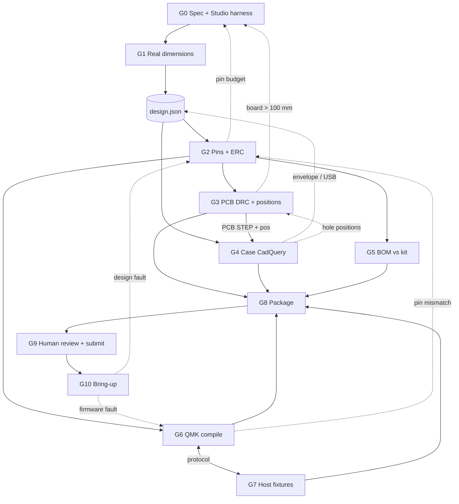

# Frostbite verification workflow

From a design spec in the Studio to a working macropad on the desk. The PCB is ordered once
(JLCPCB, $15 grant) and the case is printed once by someone else (Printing Legion). Neither can be
patched later, so the checks before submission carry most of the weight.

**Principles**
1. **One source of truth.** The chosen spec plus `FB.layoutById` produce `build/design.json`: switch
   and dial centres, OLED window, XIAO position, screw positions, pin map, LED order. KiCad placement,
   the CadQuery case, QMK `keyboard.json` and the host script are generated from it or diffed against it.
   Nobody types a coordinate or pin twice.
2. **Every gate is a command with an exit code.** Agents run it, paste its output, and do not mark a gate
   passed by reading files.
3. **Fail back to the owner of the cause.** A failure loops to the earliest stage that owns the fact
   (a USB cutout that misses the plug goes back to the XIAO position in design.json, not to CAD tweaks).
4. **The verifier did not build it.** Gates are run by the verification agent, not by the agent whose work is checked.

## Rules being enforced (with source)

| Rule | Value | Source |
|---|---|---|
| MCU | Seeed XIAO RP2040, 11 GPIO D0–D10, USB head past Edge.Cuts | Hackpad submission page, tutorial |
| I²C | OLED on D4 (SDA, GP6) / D5 (SCL, GP7); analog only D0–D3 (A0–A3) | CONTRACT, XIAO pinout |
| OLED | 0.91" 128×32, pin order **GND-VCC-SCL-SDA**, max 1 (fixed 0x3C address) | Parts page |
| Inputs | **< 16** (switches + encoders) | Submission page |
| Kit max | 16 MX switches, 16 DSA white caps, 2 EC11, 1 OLED, 16 SK6812 MINI-E, 20 1N4148, M3×16 screws, M3 heat-set inserts | Parts page |
| PCB | ≤ 100 × 100 mm, 2 layers, project name on silkscreen, "XIAO HERE" on the XIAO side | Submission page, tutorial |
| Case | ≤ 200 × 200 × 100 mm, 3D printed only (no acrylic / laser / CNC), name on a hidden face | Submission page, FAQ |
| Fits | 0.2 mm gap between printed parts; 0.2–0.4 mm printed part ↔ PCB | Resources page, CONTRACT |
| Holes | insert 4.7 mm Ø × 4 mm deep; screw pass-through 3.4 mm; self-tap 2.9 mm; PCB holes = KiCad M3 MountingHole footprints, not Edge.Cuts | Resources page |
| Footprints | MX: ai03 MX_V2; XIAO: Seeed OPL_Kicad_Library (XIAO-RP2040-DIP); EC11: KiCad Rotary_Encoder; OLED: gorbachev SSD1306-0.91 4-pin (or a 4-pin header); diode: D_DO-35_SOD27_P7.62mm_Horizontal | Resources page, FAQ ("care package") |
| Repo | `CAD/` (one full assembly .step/.stp/.3mf incl. PCB), `PCB/` (.kicad_pro/.kicad_sch/.kicad_pcb), `Firmware/`, `production/` (gerbers.zip, one STEP or STL per case part, firmware.uf2) | Submission page |
| README | screenshots of the whole hackpad, schematic, PCB, case fit; a BOM | Submission page |

## Gates

Each row: what is checked → tool / who → pass criterion → on failure, loop to.
Agents: **V** verifier, **P** PCB (schematic + layout), **C** case CAD, **F** firmware + host, **H** human.

### G0 Design spec (now: the Studio)
- **Checks:** spec values valid; `FB.check(spec).ok`; geometry: no key overlap, ≥ 1 mm between caps,
  OLED window and knobs, all inside the content area, ≥ 2.3 mm (wall + tolerance) from the rounded shell
  outline for under-plate parts; OLED board (38×12) fits under its 30 mm window in some orientation;
  XIAO has an edge position clear of switches and EC11 bodies; ≥ 4 corners take a Ø8.7 insert boss.
  Renders contain no NaN/undefined, are well-formed XML with prefixed ids.
- **Tool / who:** `node verify/run.js` (V). Also `node test/constraints.test.js` (B).
- **Pass:** exit 0, chosen spec has no warnings in `verify/report.md` → write `build/design.json`.
- **Fail:** `checker-gap:*` → constraints.js (B). Geometry warnings for the chosen spec → choose another
  layout/bezel, or the lead edits layouts.js. Render failures → A/C.

### G1 Real dimensions
- **Checks:** every `FB.dims` value cited to a datasheet or drawing (XIAO 17.8×21, OLED board and glass,
  EC11E body and bushing M7, MX cutout 14.0, MINI-E 3.2×2.8 reverse-mount hole, insert OD/length).
  When the kit arrives: caliper the OLED board, the insert, a cap and the encoder; write measured values back.
- **Tool / who:** `DIMENSIONS.md` table with source column (F now, H at kit arrival).
- **Pass:** no value without a source; measured differs from dims by < 0.2 mm.
- **Fail:** fix dims.js → rerun G0 (and G3/G4 if already past them).

### G2 Pin map and schematic
- **Checks** (against `design.json.pins`):
  - ≤ 11 GPIO, no pin used twice; D4 = SDA, D5 = SCL to the OLED; header pins 1-2-3-4 = GND, VCC, SCL, SDA.
  - Analog use only on D0–D3 (none planned); LED data on one GPIO, chain DIN→DOUT in `design.json.leds` order, every LED has a 100 nF cap.
  - Matrix: one 1N4148 per switch, same direction (COL2ROW); no column or row shorted to another net.
  - Encoder A/B on two GPIO, C to GND; push wired only if the layout says `dialPress`.
  - SK6812 on 5 V with 3.3 V data is marginal (VIH ≈ 3.5 V). Feed the first LED's VDD through a
    spare 1N4148 (≈ 4.3 V) or prove it at bring-up (G10). The kit has 20 diodes, the matrix uses ≤ 9.
  - Starting map for stratum9: rows D0 D1 D2, cols D3 D6 D7, enc A/B D8 D9, LED D10, OLED D4/D5 = 11/11. No spare pin.
- **Tool / who:** `kicad-cli sch erc --severity-error --exit-code-violations PCB/frostbite.kicad_sch`;
  `kicad-cli sch export netlist` → `verify/netlist.js` diffs nets against design.json (V).
- **Pass:** 0 ERC errors; netlist diff empty.
- **Fail:** schematic → G2 (P). Pin budget over 11 → G0 (change layout).

### G3 PCB
- **Checks:**
  - `kicad-cli pcb drc --exit-code-violations --schematic-parity` = 0 errors (silkscreen warnings may stay).
  - Board file has only F.Cu/B.Cu; Edge.Cuts bounding box ≤ 100 × 100 (parse `.kicad_pcb` or the DRC report).
  - Every footprint lib id is on the allowlist above; XIAO footprint on **B.Cu**, its USB connector ≥ 1 mm past Edge.Cuts.
  - `kicad-cli pcb export pos` centres match design.json within 0.05 mm (switches on the 19.05 grid, dial and OLED header where the case expects them).
  - M3 MountingHole footprints at design.json screw positions, ≥ 0.5 mm from every courtyard.
  - Silkscreen has "Frostbite" and "XIAO HERE" on B.Silkscreen.
  - Gerbers + drill → `production/gerbers.zip`, opened in a Gerber viewer (or JLC's preview) once.
- **Tool / who:** kicad-cli + `verify/pcb.js` (V); fixes by P.
- **Pass:** all of the above.
- **Fail:** routing/DRC → G3. Position drift → G3 (positions come from design.json). Board grows over 100 → G0.

### G4 Case (CadQuery, generated from design.json)
- **Checks** (script `verify/case.py`, CadQuery):
  - Bounding box of the assembly ≤ 200 × 200 × 100.
  - Plate cutouts 14.0 mm (+0.05 max), plate 1.5 mm at the clips or relief pockets; EC11 bushing hole ≥ 7.4 mm.
  - PCB pocket = PCB outline + 0.2–0.4 mm per side; standoffs under the PCB clear of THT pins.
  - Insert holes 4.7 Ø × 4 deep inside bosses ≥ 8.7 Ø; screw pass-through 3.4; bosses at the PCB MountingHoles.
  - USB-C cutout centred on the XIAO receptacle from `kicad-cli pcb export step` (x from the pos file, z from the stack)
    with ≥ 0.5 mm clearance around a 12.5 × 7 mm cable overmold through the full wall (bezels 9–12 mm are deeper
    than a USB-C plug reaches, so the wall needs a recess there).
  - Interference: assemble case parts + PCB STEP (with switches, XIAO, OLED, EC11 models) and
    intersect every pair; total overlap volume < 0.01 mm³. Light-gap spacer ≥ minWall.
  - Printability: no downward faces steeper than 45° from vertical outside the bed face, no bridges > 10 mm,
    each part has a flat face for the bed; walls ≥ 2.0 mm. Report any support that is still needed.
  - All parts are printed (PETG); nothing references acrylic or laser-cut sheet.
- **Tool / who:** C writes it, V runs it.
- **Pass:** all checks pass; exported `production/Top.step`, `Bottom.step`, `Spacer.step`, `CAD/frostbite.step` open again in CadQuery.
- **Fail:** case geometry → G4. Hole or connector position → G3 or G0 (design.json). Envelope → G0.

### G5 BOM vs kit
- **Checks:** KiCad BOM (`kicad-cli sch export bom`) + case hardware list diffed against the kit table;
  every overage is in `FB.check(spec).extras` and in the README BOM with a price.
- **Tool / who:** `verify/bom.js` (V).
- **Pass:** diff only lists items that are in extras.
- **Fail:** remove the part (G2/G4) or accept it as an extra (update README).

### G6 Firmware (QMK)
- **Checks:**
  - `keyboard.json` is generated from design.json: matrix pins, diode direction, encoder pins, `ws2812` driver `vendor` (PIO) on the LED pin, LED count, I²C1 on GP6/GP7, OLED driver SSD1306 128×32.
  - Layout has exactly one entry per switch; keymap layer 0 has the same count.
  - `RAW_ENABLE = yes`; the Raw HID protocol is defined only in `design.json` → `protocol` (32-byte reports,
    byte 0 = command: 0x01 SET_SLOT, 0x02 SET_ALL, 0x03 OLED_LINE, 0x04 SET_GLOW, 0x05 PING, 0x06 SET_SELECTED;
    device events 0x81 KEY, 0x82 ENCODER). Unknown commands are ignored.
  - `qmk lint -kb frostbite` and `qmk compile -kb frostbite -km default` produce `frostbite_default.uf2`, copied to `production/firmware.uf2`.
  - A test build `-km ledtest` that runs the LED chain and OLED without any switches (used at G10).
- **Tool / who:** F writes; V runs in the `qmkfm/qmk_cli` container (CI).
- **Pass:** lint clean, both builds compile, uf2 < 2 MB, keyboard.json diff vs design.json empty.
- **Fail:** firmware → G6. Pin mismatch → G2.

### G7 Host script (Claude Code hooks + training watcher)
- **Checks:**
  - Claude Code hooks (`PreToolUse`→run, `Notification` permission prompt→needs, `Stop`→done, tool error→error) map to slot statuses; one slot per session id.
  - Training watcher: tail a log, NaN/Inf loss or a traceback → error, final epoch/"done" marker → done, stale log > N min → needs.
  - Fixture replay: recorded hook JSON payloads and three training logs (normal, NaN at step 812, crash) piped through the script against a fake HID device; assert the exact report bytes from PROTOCOL.md.
  - Survives the pad being unplugged and plugged back in; latency from event to report < 200 ms.
- **Tool / who:** F writes; V runs `node host/test.js` (or `pytest`).
- **Pass:** all fixtures produce the expected byte stream.
- **Fail:** host → G7. Protocol change → G6 and G7 together.

### G8 Submission package
- **Checks:** repo tree matches the Orpheuspad example: `CAD/` one assembly file, `PCB/` three KiCad files,
  `Firmware/`, `production/` with `gerbers.zip`, per-part STEP/STL, `firmware.uf2`. README has the five
  required items (hackpad render, schematic, PCB, case fit / exploded, BOM) and every image link resolves.
  Screenshots come from `kicad-cli sch export svg`, `kicad-cli pcb export svg` and the CadQuery render, so they are current.
- **Tool / who:** `verify/package.js` (V).
- **Pass:** no missing file or broken link; all G0–G7 green on the same commit hash.
- **Fail:** the gate that owns the missing artifact.

### G9 Human review before money is spent
- Print the PCB at 1:1, set switches, caps, OLED and knob on the paper; plug a USB-C cable into a XIAO held
  at its spot behind a wall offcut of the right thickness. Read the README as a reviewer. Make the ship post and fill in the form.
- **Fail:** whichever gate the problem belongs to. The only gate that cannot be automated.

### G10 Physical bring-up (kit, PCB and case arrive)
Order matters; stop at the first failure.
1. Bare PCB: continuity VBUS–GND, 3V3–GND open; every matrix row/column isolated from its neighbours.
2. Solder the XIAO (underside) only. Flash the `ledtest` uf2. Solder the LEDs and OLED: all N LEDs light in
   chain order, colours correct (GRB order), no flicker at full white; I²C scan finds 0x3C; OLED text upright.
3. Diodes, then switches (check stripe direction before soldering all). QMK `KEY_LOG` / matrix tester: each key once, no ghosts.
4. Encoder: clockwise = volume up / next slot; if reversed, swap pins in keyboard.json, do not resolder.
5. Raw HID: host `ping` returns the firmware version; replay one fixture and watch the slots change.
6. Case: PCB drops into the pocket without force, USB-C plug seats fully, inserts take the screws straight,
   switches clip into the plate, caps clear the plate and each other, glow gap evenly lit.
- **Fail:** assembly fault → rework and repeat the step. Design fault → note it under "Rev B" in the README and
  loop to G2/G3/G4; firmware fault → G6.

## The loop



**Sequential:** G0 → G1 → design.json → G2 → G3 → G8 → G9 → G10. G4's final interference run needs the G3 PCB STEP.
**Parallel once design.json exists:** G4 (draft from design.json), G6, G7 and the PCB work run side by side.
G5 runs whenever the schematic changes. Every gate reruns on every commit in CI; a change upstream
invalidates everything downstream of it in the diagram.

## How many agents and when

| Phase | Agents | Why that many |
|---|---|---|
| Studio (now) | 6: A top render, B catalog/constraints, C side render, D page, E verification, F dims | separate files, no shared state beyond the contract |
| Spec freeze, G0–G1 | 1 (V) + human picks the spec | a decision, not parallel work |
| Hardware design, G2–G7 | 4: **P** schematic + PCB (one agent, the two change together), **C** case, **F** firmware + host (share the protocol), **V** runs gates and the cross-checks between them | the three builders never edit the same file; V owns design.json and every `verify/*` script |
| Package, G8 | 1 (V) | assembling, not designing |
| Human review, G9 | human | the paper print and the form |
| Bring-up, G10 | human + 1 agent for firmware/host debugging | hands on hardware are the bottleneck |

Peak is 4 agents. Splitting schematic from layout, or firmware from host, would add handoffs on the
two interfaces most likely to break (netlist and Raw HID protocol) without saving time.

## Running the current gate

```sh
node verify/run.js            # ~2 s, writes verify/report.md, exit 1 on any hard failure
node verify/run.js --random 5000 --seed 7
```
