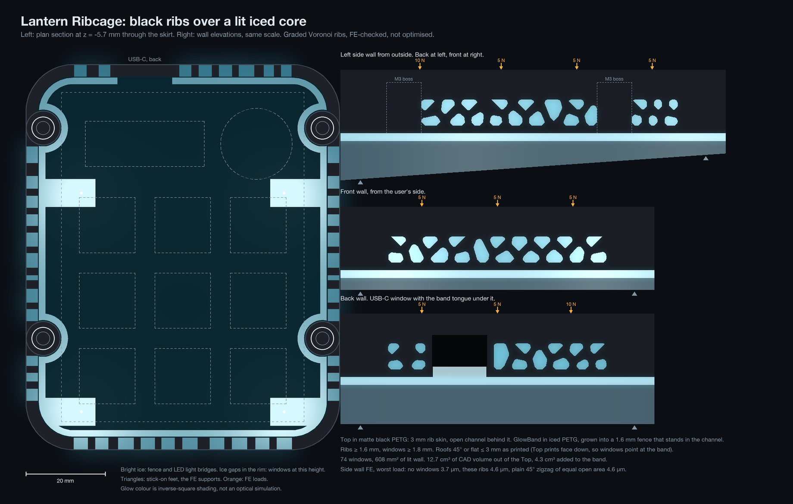
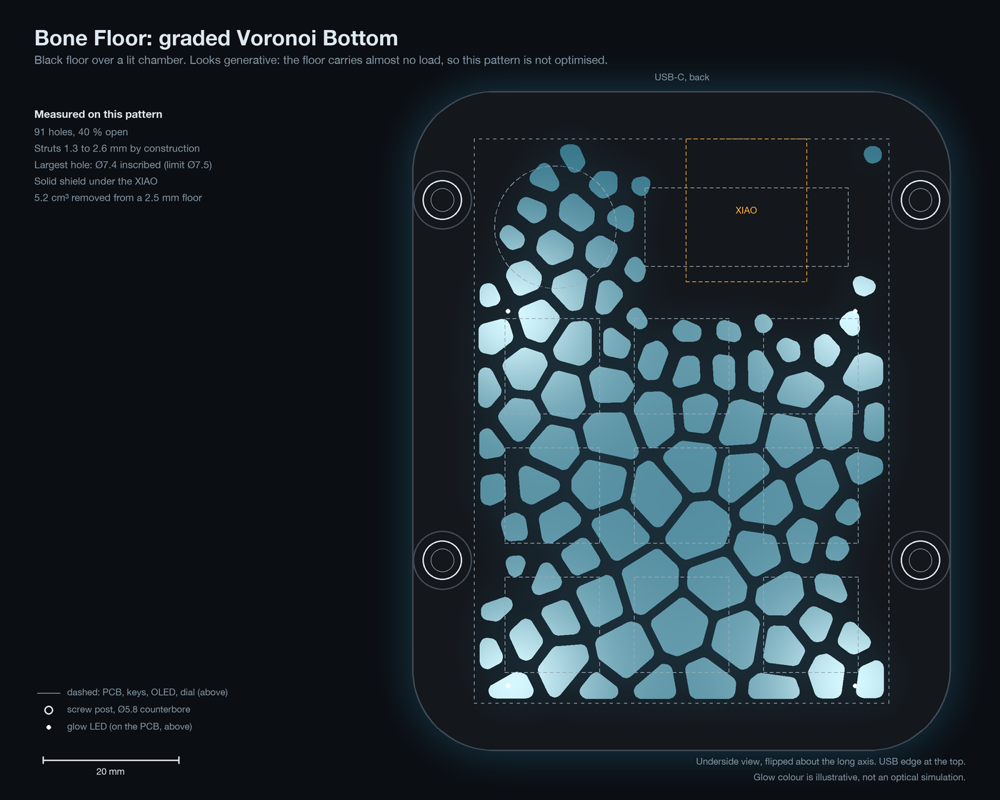
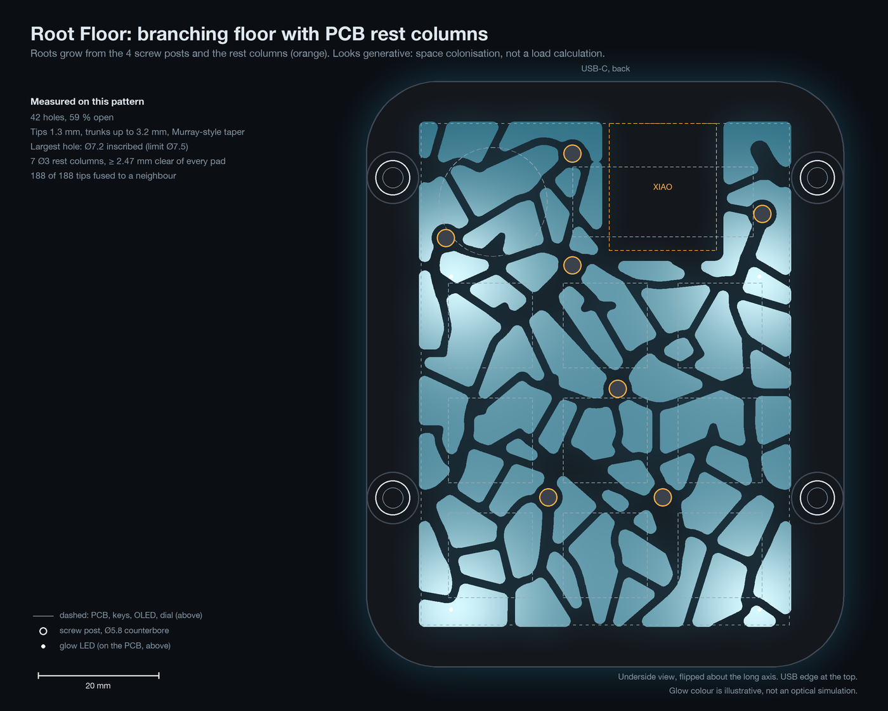
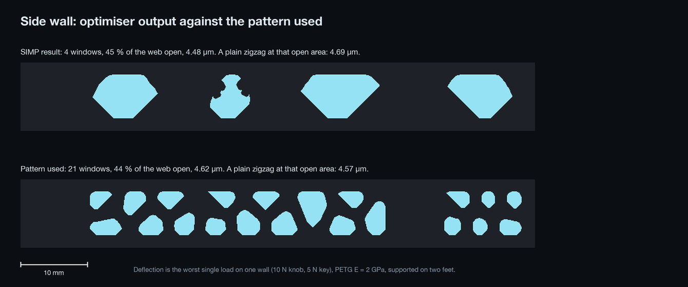

# Frostbite generative concepts

Ideas for a more futuristic case: bone, webbing, black ribs over a glowing core. Nothing in `CAD/`, `design.json` or `production/` has changed. Every number here comes from `generate.py` (saved in `results.json`) unless it is marked "estimate".

The drawings use the live `design.json`: shell **79.15 × 97.15**, R12, screw axes at x −4.65 and 65.8. The B1 fix landed at 79.15, wider than the audit's suggested 76.35. Rerun the script if that moves again.

```sh
~/.local/bin/uv run --python 3.12 --with shapely --with numpy --with scipy --with pillow \
    --with scikit-image docs/concepts/generative/generate.py          # 20 s, uses cached SIMP fields
# add --force to rerun the topology optimisation (about 2 min), --check for the FE benchmark only
```

## Recommendation

**Try Lantern Ribcage first, and start with a printed wall coupon, not the whole case.** It puts the webbing on the walls, where people actually look. It also turns audit finding M2 (the glow band gets too little light) into the main feature. Rework is about one or two evenings of CAD, plus the coupon. Details are under [Rework for the pick](#rework-for-the-pick).



## What the numbers say about this object

These five findings decide the ranking.

1. **Strength is not the limit.** In a 2D wall model on two feet, with the whole 5 N key or 10 N knob load on one wall, deflection is 4 to 6 µm and peak stress is about 1 MPa or less, for every pattern tried. Printability, glow and how it feels in the hand decide this design.
2. **The floor carries almost nothing.** Key load goes plate → skirt → desk. So any floor pattern is decoration plus protection, and it "looks generative". Only walls are worth a load calculation.
3. **Nobody sees the floor in use.** It sits on the desk. A floor pattern only shows when the pad is flipped, in photos, or as a soft edge of light if the pad stands on feet.
4. **The slicer already builds bone.** 4 perimeters and 25 % gyroid is a dense skin over a spongy core. An 8.7 mm wall prints at about 56 % density (estimate). So CAD volume overstates real savings. Case total today: Top 43.3, Bottom 28.0, GlowBand 10.4, Knob 3.2 cm³, at most 108 g. This is a look, not a material saving.
5. **The PCB fills the space under the plate.** It sits 2.5 mm under the plate, leaving only the 8.7 mm side walls and 6.7 mm end walls for deep structure. Any real optimisation is boxed into those strips.

## Concepts

| # | Concept | Parts changed | Supports | Weakest feature | Risk to function | CadQuery effort | Verdict |
|---|---|---|---|---|---|---:|---|
| 1 | Lantern Ribcage | Top, GlowBand | None | Rib 1.6 × 3 mm | Glow level unproven | Medium, 2.5D | **Try first** |
| 2 | Bone Floor | Bottom | None | Strut 1.3 mm | Small objects can reach the chamber | Low, 2.5D | Yes, later add-on |
| 3 | Root Floor | Bottom | None | Tip 1.3 mm | Same as 2, columns need test fit | Low to medium | Only if N6 needs fixing |
| 4 | Ghost Web | Bottom | None | Skin 0.6 mm | Needs a filament swap mid-print | Low, 2.5D | Yes, better than 2 if a printer agrees |
| 5 | Fin Ring | Top, GlowBand | None | Fin 1.6 × 3 mm | Same as 1 | Medium, 2.5D | Fallback for 1 |
| 6 | Gyroid Skirt | Top | Usually none | Wall 1.2 mm | Dust, no STEP output | High, mesh only | No |
| 7 | Open Skeleton | Top split, GlowBand gone | None | Plate and posts | Loses the light gap | High | No |

### 1. Lantern Ribcage

**Idea.** The Top becomes matte black PETG. Its skirt is reduced to a 3 mm rib skin with 74 bone-shaped windows in a 6.8 mm tall belt. Behind the ribs is an open channel. The GlowBand, in iced PETG, grows a 1.6 mm fence that stands in that channel, so the ribs read as black webbing against a lit wall. The 2 mm light gap stays, directly under the belt. The Bottom can stay iced and unchanged.

**Glow.** The audit measured about 85 % of the LED light landing on the band's pads, then leaking into the Top skirt instead of the ring. Here the pads, ring and fence are one iced part and the black Top stops the bleed, so that leak becomes the display. A black Top also removes the glow around the OLED lip (N9). As a very rough estimate, the lit wall could reach around 100 cd/m² against the audit's 50 for the band. That rests on an assumed 40 % of pad light escaping, so treat it as a reason to test, not a result.

**Why the channel matters.** My first version kept the 8.7 mm wall and cut windows through it. That fails from where you actually sit. Looking down at 30°, only 26 % of a 6.8 mm window would show the fence, and at 45° none would. With 3 mm ribs those become 75 % and 56 %.

| Check | Result |
|---|---|
| Overhangs | Top prints face down, so windows must close toward the band. Every roof is 45° or a flat bridge of at most 3.0 mm, measured on the final pattern. The gussets give the windows their pointed look. |
| Min feature | Ribs ≥ 1.6 mm (4 lines at 0.4 mm), above the 1.2 minimum because fingers touch them. Windows ≥ 1.8 mm. Fence 1.6 mm. |
| Key load | 4.6 µm on the side wall, 0.8 MPa peak. |
| Finger poke | Hand calculation, 20 N on one rib of 4 mm span: about 4 MPa, against an estimated 20 to 30 MPa across layers. Fine. A drop on a corner is untested. |
| Screws | Bosses stay Ø8.7 with 2.0 mm walls around the Ø4.7 holes (≥ 1.3). They become visible posts in the channel. Clamp load runs through them, not the ribs. |
| Assembly | The PCB pocket is unchanged, so the B1 fix still holds. The fence goes in after the PCB. It stays 2.6 mm below the PCB where it passes inside the bosses, clear of 2.0 mm lead tails. In the spans it can rise to −0.9. |
| Dust and cleanup | Windows are shallow, a soft brush reaches them. Stringing in 74 windows is the likely cleanup job. Black PETG shows it less. |
| Light leaks | Intended through the windows. USB window leaks a little. |
| Sharp bits | Add a 0.4 mm chamfer on the outer rib edges. |

Material: 12.7 cm³ out of the Top (29 %), 4.3 cm³ into the GlowBand. In printed mass that is only about 3.5 g saved (estimate), because the ribs and fence print solid.

### 2. Bone Floor



**Idea.** Black Bottom with 91 Voronoi through-holes in the 2.5 mm floor, 40 % open. Struts run 1.3 to 2.6 mm, thicker toward the posts and the XIAO. A solid shield stays under the XIAO. The largest hole is Ø7.4 inscribed, which keeps fingers and coins out. Light falls through onto the desk.

**Assessment.** The easiest print of the set: every wall is vertical, so there are no overhangs or supports. Key and screw loads don't pass through it. Solder joints sit about 10 mm above the floor, so a fingertip won't reach them, but a paperclip could. Dust falls in and out, and open cells can be blown clear. Light leaking is the point here, and an iced Bottom would show less contrast, so it needs black. Saves 5.2 cm³ (about 6.6 g).

**Verdict.** Safe and cheap, but mostly invisible in use. This is "looks generative": nothing is optimised.

### 3. Root Floor



**Idea.** Branching veins grow from the four screw posts and seven Ø3 rest columns, with tips 1.3 mm and trunks to 3.2 mm. The columns stand on the floor and stop 0.3 mm below the PCB. That is a real function: the PCB currently hangs from the switches only (N6), and the back 26 mm has none. All columns clear every bottom-side pad by at least 2.47 mm, checked against `PCB/build/bottom_pads.json`. 59 % open, largest hole Ø7.2.

**Assessment.** Prints like Bone Floor, and the columns are simple vertical posts. Column height depends on the print, so check the 0.3 gap by test fit, or sand it. Every tip is fused to something, so no free ends can snag. Saves about 6.9 cm³ after columns.

**Verdict.** The most organic look, and also the one with a real job, but the audit rates N6 as tolerable. Space colonisation is a growth rule, not a load calculation, so it also only "looks generative". Pick it if the knob or USB flexes the PCB on a real build.

### 4. Ghost Web

**Idea.** Same pattern as Bone Floor, but the holes stop 0.6 mm above the underside. The Bottom prints in iced PETG for the first 0.6 mm, then swaps to black at one layer. You get black bones behind a closed frosted skin, lit from the chamber. It needs no multi-colour printer, only a pause and a manual swap. Colours differ only by height, so this works on the floor and not on the walls.

**Assessment.** Solves Bone Floor's problems: closed surface, no dust, no reach-in, no leaks, full XIAO protection. The 0.6 mm skin spans cells up to Ø7.4, so don't press hard on it, and print it as 3 full layers. Same polymer, so the swap layer should bond well. A thin iced line also shows around the base of the rim. The catch is people: a Printing Legion volunteer must agree to the swap, and the audit already notes they promise no material. One boolean change from concept 2.

**Verdict.** The best floor option if someone will do the swap. A variant for the wall idea: thin the inside of a closed iced skirt so a pattern shows only when lit. It works in one material, but the ribs would read grey, not black.

### 5. Fin Ring

**Idea.** Same channel and fence as Lantern, with the windows replaced by vertical slots: fins 1.6 mm wide at 3 to 4 mm pitch. Gap width grows with distance from the LEDs, so the dim back wall opens up more. That grading can use the script's inverse-square model, a first-order evening-out only.

**Assessment.** Fins run along the real load direction. Euler buckling for a 1.6 × 3 × 6.8 mm fixed fin is above 1 kN (hand calculation), far beyond any key load. Slot tops are flat bridges up to 3 mm. Dust brushes out easily. It reads as a heatsink, more engineered and less bone.

**Verdict.** A free second variant of concept 1: only the window polygons change. Use it if Voronoi looks too busy on the coupon.

### 6. Gyroid Skirt

**Idea.** The skirt becomes a real gyroid sheet at about 8 mm cell size, black over an iced core. There is no straight line of sight through it, so it would hide LED hot spots.

**Assessment.** Short-cell gyroids usually print without support, but near-flat saddles at this scale may sag. Walls of 1.2 mm in a 3 to 8.7 mm wall leave room for barely one cell, so it won't read as a lattice. CadQuery can't build it. You would use marching cubes and a mesh boolean, and lose the STEP files that Hackpad submissions and `check_fit.py` rely on. It's the worst dust trap of the set. The slicer shortcut (remove the walls so the infill shows) leaves single 0.45 mm lines, far too fragile.

**Verdict.** No, except as a small coupon for fun.

### 7. Open Skeleton

**Idea.** Remove the skirt. A 2.5 mm plate floats on four black posts over an iced tray, with the PCB edge exposed.

**Assessment.** The biggest rework: Top splits, GlowBand goes, and insert posts, USB support and plate stiffness all need new design. The 2 mm light gap, the core of Frostbite's look, disappears into an open slot. Dust reaches the PCB, and the plate relies on the switches and PCB for stiffness. Printing is easy.

**Verdict.** No. It looks dramatic, but it costs more than it gives on a part this small.

## Real topology optimisation

**I ran one.** `generate.py` includes a 2D plane-stress SIMP solver (density filter, Heaviside projection, multiple load cases) on each wall, with feet as supports and bosses and rails kept solid. Against Timoshenko beam theory the FE is within 0.6 %.

| Wall | No windows | SIMP result | 45° zigzag, same open area as SIMP | Pattern used | 45° zigzag, same open area as pattern |
|---|---:|---:|---:|---:|---:|
| Side | 3.72 µm | 4.48 | 4.69 | 4.62 | 4.57 |
| Front | 4.19 µm | 5.58 | 5.80 | 5.99 | 5.80 |
| Back | 3.93 µm | 4.71 | 5.93 | 5.20 | 5.74 |

- SIMP beats a plain zigzag by 4 % on the side and front walls and 21 % on the back wall, where the zigzag handles the USB cut-out badly. That is about 1 µm at most. You can't feel it.
- SIMP gave only 4 to 6 big windows, even from a seeded fine start. Compliance favours a few thick members, and that is not the web you asked for.

So the wall pattern is a **graded Voronoi: cells shrink where the solid wall stores more strain energy, then the FE checks the result**. It's informed by one FE field, but it is not optimised. Call it "looks generative, FE-checked".



Limits of this model: 2D and linear, isotropic PETG at a datasheet-style 2 GPa, no layer-strength effects, no PCB stiffening, and no drop loads. Load on one wall is deliberately pessimistic.

**A full 3D run** is possible for free with [FEMbyGEN](https://wiki.freecad.org/FEMbyGEN_Workbench), a FreeCAD addon that uses [BESO](https://github.com/calculix/beso) with the CalculiX solver. Expect to spend an evening or more on setup. I have not run it on this design, and forum users report it can be slow.

**Is it worth it? No.** The part is many times stronger than it needs to be, and the design space is thin strips. The output is also a mesh, which you would have to redraw to keep STEP files. Use optimisation here as a check, as above, not as a shape generator.

## Rework for the pick

Times are estimates.

**Step 0: coupon, one evening.** Print one wall section with a matching fence and pad, and light it with a single SK6812 at 27 %. Use a 40 mm length of the side-wall pattern. This also settles M2, which needs a test print anyway. Check brightness, how the ribs read from a seated angle, stringing, and bridge quality in black.

**Step 1: CAD, one or two evenings, only if the coupon works.**

| File | Change |
|---|---|
| `CAD/frostbite_case.py` `make_top` | Cut the channel (z −9.4 to −0.8, outline from `lantern_plan()`). Cut windows from `patterns/lantern_windows.json`. Keep bosses. |
| `CAD/frostbite_case.py` `make_band` | Add the fence and light bridges. Keep the 0.3 set-back from M1. Reduce fence height where it runs under the PCB. |
| `CAD/check_fit.py` | Update band checks. Add checks for rib width, window roofs, and fence against XIAO, USB and lead tails. The thin-wall warnings will need new limits. |
| `verify/`, `studio/`, `docs/`, `CAD/README.md` | Update band description, material list and renders. |

**Step 2: print.** Black Top, iced GlowBand, and the Bottom reused if already printed. Ask the Printing Legion printer first: a second filament colour is the main outside risk, and the audit notes a test print isn't obviously on offer there. If you can't print the coupon yourself, that risk goes up, and Bone Floor becomes the safer first step.

**Costs of choosing it.** You lose the all-ice look. Frosted keys against black should give stronger contrast, but that trades the current style. Corners stay solid black for now because windows are flat cuts; wrapping them around R12 is harder. One pattern is mirrored to both side walls.

**Good later add-on.** Ghost Web or Bone Floor on a black Bottom. A full-height lantern would also need a separate iced liner in the Bottom, because a band with fences both up and down can't print flat without supports.

## Files

| File | What it is |
|---|---|
| `generate.py` | Everything: geometry from `design.json`, FE and SIMP, patterns, drawings |
| `concept-1-lantern-ribcage.png` | Plan section and three wall elevations, to scale |
| `concept-2-bone-floor.png`, `concept-3-root-floor.png` | Underside views, to scale |
| `simp-vs-pattern-side-wall.png` | SIMP result beside the pattern used |
| `patterns/*.json` | Polygons in mm, ready to extrude or cut in CadQuery |
| `patterns/wall_*.npz` | Cached SIMP fields |
| `results.json` | All measured numbers |

Glow colours in the images are simple shading, not an optical simulation.
