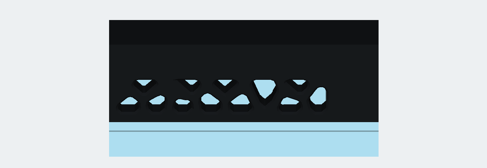
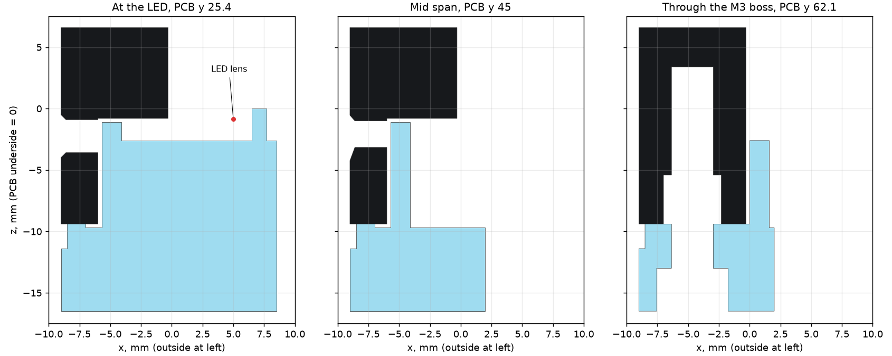

# Lantern Ribcage wall coupon

A small test piece for concept 1 in [`../README.md`](../README.md). It is not a commitment to that case, and nothing in `CAD/`, `production/`, `PCB/` or `design.json` changed. The window pattern is the concept's graded Voronoi: a pattern checked by FE, not the result of a search for the best shape.



The render uses flat material colours. It shows what lines up with what, not how bright anything will be.

## The two parts

| Part | Material | Size, mm | Solid volume | Print time (estimate) | Orientation as exported |
|---|---|---:|---:|---:|---|
| `coupon-wall.step` / `.stl` | Matte black PETG | 8.7 × 47.9 × 16 | 4.3 cm³ | about 25 min at 25 % gyroid | Plate face on the bed, ribs up, as the real Top |
| `coupon-fence.step` / `.stl` | Iced PETG | 17.5 × 47.9 × 16.5 | 5.1 cm³ | about 29 min at 100 % infill | Base on the bed, fence up |

Print settings are the ones in `CAD/README.md`: 0.4 mm nozzle, 0.2 mm layers, 4 perimeters, no supports. Use 100 % infill for the iced part, the same as the real GlowBand, because infill changes how light travels. Note the settings you used next to your result.

The times come from slicing the meshes with an assumed speed model, not from a slicer. Treat them as ±30 %. Check them in your slicer before printing.

It is the left side wall, PCB y 19.1 to 67.0, at real scale. That is 47.9 mm rather than 45, because the LED (y 25.4) and the M3 boss (y 62.1) stay at their real spacing. The section therefore covers the full run from the LED to the dimmest point on the side wall (y 53) and on to the boss.



### Same as the concept

- 3 mm rib skin, 12 whole windows from `patterns/lantern_windows.json`, 0.4 mm outer chamfer
- Channel from z −9.4 to −0.8, with the 1.8 mm rail above the band
- 1.6 mm fence with a 0.3 mm gap behind the skin, wrapping the boss, stepping down to z −2.6 where it passes the PCB edge
- Light bridge and pad, 7 mm wide, with pad top at z −2.6
- LED 9.1 mm from the fence and 14.0 mm from the outer skin, lens 1.76 mm above the pad
- Ø8.7 boss, Ø4.7 × 4 insert hole, Ø3.4 screw hole, Ø5.8 counterbore. The kit M3×16 lands as in the real stack

### Different for the coupon

- **Fence top at z −1.1, not −0.9.** See [what the check found](#what-the-check-found).
- **End caps.** The 1.2 mm black caps close the cut channel. The real wall has none.
- **Base.** The 5.1 mm base stands in for the Bottom's rim and is one piece with the ring. The real parts meet at a seam, so here more light can leak down into the base.
- **Base under the pad.** The real pad floats inside the case. Here it needs a footing to print without supports.
- **LED pocket.** A U of rails, open toward the fence, replaces the PCB. LED leads rest on the rails at the PCB underside plane, and the block behind sets LED x.
- **No riser wall.** The concept's plan shows only the fence and bridges, so the coupon does too.

## Putting it together

1. Press a real heat-set insert into the boss, using your normal PETG technique.
2. Solder wires to one SK6812 MINI-E. Drop it lens-down between the rails and push it against the back block. Hold it with tape.
3. Seat the black part over the fence. The fence around the boss locates it. Fit the M3×16 from underneath.
4. Tape over the pad, the LED and the open back with black tape, so only the windows and ring can emit light. For a phone torch, leave a 4 mm hole above the pocket.

The glow setting is `#7fe3ff` at about 27 %, roughly RGB 34, 61, 69. A loose LED needs a small test sketch, because `led-test.uf2` runs its own colours and the firmware drives the glow on chain positions 9 to 12. A phone torch is much brighter than this, so it can only show layout, rib contrast and leaks. It says nothing about brightness.

## What to look for

Lit, in a dim room and then under normal desk light:

- **Brightness.** Are the windows clearly lit at 27 % from about 50 cm?
- **Fall-off.** Compare the windows in front of the LED with those near y 53, in one photo with locked exposure.
- **Rib contrast.** From a seated angle, do the ribs read as black webbing? The concept's geometry says 75 % of a window shows fence at 30° and 56 % at 45°.
- **Leaks.** Does any light come through the black ribs themselves?
- **The ring.** Does the 2 mm band under the belt glow along its length?

Unlit and in the hand:

- **Stringing.** Time how long it takes to clean all 12 windows. The whole case has 74, about six times as many.
- **Bridges.** Check the flat roofs in black. They are the window edges nearest the band, and the widest here is 2.54 mm.
- **Boss to rib.** This is the likeliest place to fail. The channel leaves the boss with a free-standing 2.0 mm wall. Look for bulging on the outer skin after pressing the insert, and for layer splits where the boss joins the skin after tightening the screw.
- **Fit.** The black part should sit flat on the ring with an even gap. The fence must not touch the channel roof or rattle.
- **Feel.** Press a rib hard with a thumb, then run a finger along the wall to check for sharp edges.

## What would make me drop it

These thresholds are judgement calls, not measurements. Any one of them is a good reason to stop or switch.

| Result | Decision |
|---|---|
| Near y 53 the windows look dark at 27 % in a dim room | Drop. The real wall has a second LED at the same distance, though its light must pass the boss, so try double the setting before deciding. If that is still dark, the idea does not work |
| Windows at the LED blow out while mid-wall windows look dark in the same photo | Don't build as drawn. Rework the light path or try Fin Ring grading |
| Boss cracks, or the skin visibly bulges when the insert goes in | Stop until the boss is redesigned. Four of these hold the case together |
| Boss or skin splits along layers when the screw is snug | Same as above |
| Cleaning 12 windows takes over 5 minutes, or scars the ribs | Drop the Voronoi windows and try Fin Ring. 74 windows would be about 30 minutes or more |
| Roofs sag enough to show from a normal viewing distance | Reduce the maximum bridge, then reprint. Drop if black PETG still sags |
| Ribs do not read as black at a seated angle | Drop. That look is the whole reason for the concept |
| You cannot print this or get black plus iced PETG | Move to Bone Floor, as the concept suggests |

## Honest limits

- **It cannot show the full case's brightness.** One LED feeds one direction here. The real case has four LEDs and a closed chamber whose iced Bottom and PCB bounce light back. A real wall may be brighter at mid-span, and dimmer next to an LED, because each LED also feeds another wall.
- **The concept's 100 cd/m² stays unproven.** This coupon can reject the idea, or make it worth building. It cannot confirm that number.
- **It does not settle the far end of the wall.** The coupon stops at the boss, so light past the boss and around the R12 corners is untested.
- **The base is one piece with the ring.** The real seam is missing, so ring and base brightness won't match the real parts.
- **The widest roofs are not in this section.** The full pattern reaches 2.9 mm flat, and this section stops at 2.54 mm.
- **It says nothing about drops.** A straight 48 mm piece also won't show warping across the full 97 mm wall.
- **The print is one sample.** Results depend on the filament and printer, and the Printing Legion's printer may differ from yours.

## What the check found

`verify_coupon.py` measures the exported meshes. Numbers are in `results.json`.

| Check | Wall | Fence |
|---|---|---:|
| Watertight, one body | Yes | Yes |
| Smallest rib between windows | 1.614 mm (limit 1.6), at y 54, z −6.1 | n/a |
| Smallest window, inscribed circle | Ø2.27 mm (limit 1.8) | n/a |
| Smallest rail or rib to the wall outline | 1.617 mm | n/a |
| Thinnest wall around the insert | 2.0 mm | n/a |
| Fence thickness and gap | n/a | 1.6 mm, 0.3 mm gap |
| Overlap with the other part | 0 mm³ | 0 mm³ |

Nothing in the concept turned out to be unprintable. Four details differ from how it reads:

1. **Fence height.** The concept's z −0.9 leaves 0.1 mm under the channel roof at −0.8. FDM can't hold that, and the fence would lift the Top off the ring. The coupon uses −1.1, a 0.3 mm gap like the rest of the design, which hides nothing from a seated view.
2. **Roofs.** The widest flat roof, with its joining facets, is 2.54 mm here, within the 3.0 limit. "45° or flat" is close but not literal: short facets, at most 0.35 mm long, reach 71° here and 84.5° in the full pattern. They cover 2.9 mm² in this section, sit at the ends of flat roofs and behave as part of the bridge. Another 2.2 mm² is one gusset at 45.5°.
3. **Chamfer.** The 0.4 mm chamfer leaves a 1.6 mm rib only about 0.8 mm flat at the surface (1.01 mm measured 0.1 mm deep). The ribs will look finer than 1.6 mm, and that is worth judging on the print.
4. **Window tops.** They stop at z −0.9, 0.1 mm below the channel roof. That lip is thinner than a layer and the slicer will swallow it.

The iced part has one flat roof: the Ø5.8 counterbore ceiling, a 1.2 mm wide ledge, the same as the real Bottom. Everything else on it is vertical or faces up.

## Files

| File | What it is |
|---|---|
| `coupon-wall.*`, `coupon-fence.*` | The two parts in print orientation |
| `build_coupon.py` | CadQuery source. Reads `design.json` and `CAD/frostbite_case.py`, writes nothing outside this folder |
| `verify_coupon.py`, `results.json` | Mesh checks and results |
| `preview_coupon.py`, `preview-*.png` | Renders and sections, flat colours only |
| `build.json` | Part sizes and print-frame offsets, used by the check |

```sh
CAD/.venv/bin/python docs/concepts/generative/coupon/build_coupon.py
verify/.venv/bin/python docs/concepts/generative/coupon/verify_coupon.py
CAD/.venv/bin/python docs/concepts/generative/coupon/preview_coupon.py
```
